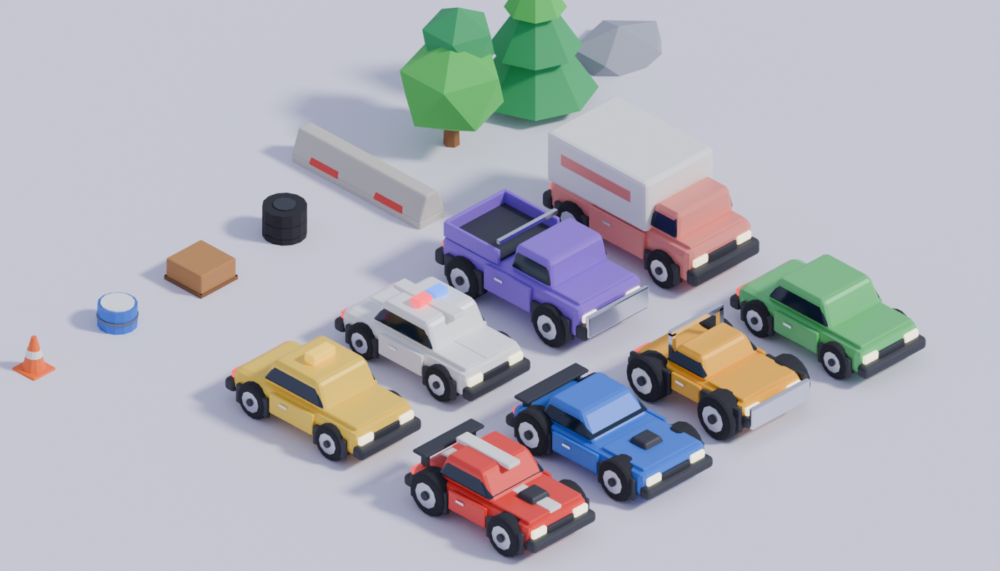

# Mochi Pet

Um cozy pet game mobile no estilo Pou, com bichinhos de gelatina brilhante. Roda direto no navegador, sem build e sem dependências.

## Como jogar

- **Cozinha**: arraste a comida até a boquinha (ou toque nela para dar). Cada comida custa moedas.
- **Banho**: esfregue o sabonete no bichinho e depois segure o chuveiro para enxaguar a espuma.
- **Quarto**: apague a luz para ele dormir e recarregar a energia.
- **Brincar**: arremesse a bolinha nele ou jogue a **Chuva de Doces** para ganhar moedas.
- **Closet**: troque de bichinho (Mochi, Coelho, Gato), compre cores e acessórios.

Toque no bichinho para cutucar, arraste o dedo em cima dele para fazer carinho. Se cutucar demais ele fica tonto.
As necessidades (fome, energia, diversão, higiene) caem com o tempo, e o progresso fica salvo no navegador.

## Rodando

Sirva a pasta com qualquer servidor estático (o renderizador 3D usa módulos ES, que não carregam via `file://`; nesse caso o jogo cai para a versão 2D):

```sh
npx http-server .
```

No celular, acesse o endereço da sua máquina na rede local (ou publique no GitHub Pages) e use "Adicionar à tela de início" para jogar em tela cheia.

## Estrutura

- `index.html`: estrutura da interface
- `style.css`: visual da interface
- `game.js`: lógica do jogo, física de molas para squash & stretch, cômodos, minigame, sons sintetizados com Web Audio e renderização 2D (cenário, partículas, ícones e fallback do bichinho)
- `pet3d.js`: bichinho em 3D com Three.js. Corpos gerados por revolução do contorno de cada espécie e um `ShaderMaterial` "jelly" próprio:
  - vertex shader: balanço de gelatina (o topo atrasa em relação à base) e ondulação que se espalha a partir do toque
  - fragment shader: gradiente de altura, subsurface/translucidez falsos, fresnel, reflexos de estúdio e o rosto projetado na superfície (desenhado num canvas e usado como textura, então todas as expressões animam)
- `vendor/three.module.min.js`: Three.js r160 (MIT), embutido para funcionar offline; se faltar, carrega da CDN

---

# Gramado Estelar

Minigolfe isométrico em pixel art, flutuando num céu de pôr do sol, inspirado em Kirby's Dream Course, com personagens próprios. Fica na pasta [`estelar/`](estelar/).

## Como jogar

- Arraste para trás e solte para tacar. A linha pontilhada mostra o começo do caminho.
- Derrube todos os inimigos. O último vira o buraco, e aí é só acertar a bola nele.
- **Pulo**: liga a tacada aérea, para passar por vãos, água e acertar inimigos voadores.
- Durante a rolagem, segure para frear. Se tiver uma habilidade, toque para usá-la:
  - **Rocha**: para na hora.
  - **Turbo**: dá uma arrancada.
  - **Mola**: dá um quique alto.
- Ouriços não podem ser derrotados e rebatem a bola. Água e vãos custam uma tacada.
- Personagens: Pipo (equilibrado), Brasa (força), Nimbo (pulo) e Musgo (controle).
- 6 buracos com rampas, areia, gelo, setas de turbo e rebatedores.

Teclado: `J` liga o pulo, espaço freia ou usa a habilidade, `Esc` pausa.

## Estrutura

- `estelar/holes.js`: os buracos, descritos como mapas de texto (tipo de piso + altura por casa)
- `estelar/game.js`: física isométrica com alturas e rampas, renderização em baixa resolução ampliada sem suavização, sprites gerados por código (personagens e inimigos são esferas iluminadas rasterizadas pixel a pixel, por isso rolam de verdade), música chiptune e efeitos sintetizados com Web Audio

---

# Mini Fúria (Godot 4)

Corrida isométrica de **combate** com mini carros, feita em **Godot 4.7** (renderizador Compatibility, roda no navegador e no celular). Projeto em [`minifuria/`](minifuria/): abra o `project.godot` no Godot.

Referências de game design: **Rock n' Roll Racing** (armas e nitro limitados que recarregam a cada volta, dinheiro por colocação e por rival destruído, upgrades na garagem), **Hot Wheels Unleashed / Trackmania** (loopings, espirais, rampas, boosters antes dos elementos) e **Burnout** (takedowns, batidas e destruição). Só os carros da corrida ficam na pista (sem trânsito).



## Fluxo do jogo

Menu → **escolha da pista** (10) → **garagem** → corrida de 3 voltas contra 4 rivais armados → **resultado** com prêmio em dinheiro → próxima pista. O progresso (dinheiro, upgrades, equipamento, melhores colocações) fica salvo.

- **Carros**: Faísca (equilibrado), Trovão (pesado e blindado), Vespa (rápida e ágil, mas frágil).
- **Arma frontal**: Metralhadora (60 tiros por volta, mira automática no cone da frente) ou Lança-foguetes (4 por volta, teleguiado leve, explosão em área).
- **Arma traseira**: Minas (jogam o carro para o alto) ou Óleo (faz o carro rodar).
- **Nitro**: Curto (4 arrancadas de 1 s) ou Longo (2 de 2,6 s). Drift, pulos, quase-batidas e takedowns enchem um medidor que dá cargas extras.
- **Upgrades** (3 níveis cada): Motor, Blindagem, Munição e Nitro +1.
- Na pista: caixas de **munição**, **reparo** e **nitro**; boost pads; barris e pneus destrutíveis.
- Cair da pista (vãos, água, lava, nuvens) ou ser destruído faz você voltar um pouco atrás, piscando.

## Pistas

São 26 pistas: 24 nos 6 mundos da carreira (4 por tema; veja **Carreira** abaixo) mais 2 extras (Docas do Porto e Loop Mania) na corrida rápida e no multijogador. Temas:
- **Parque**: dia e morros.
- **Pântano**: entardecer, taboas e vaga-lumes.
- **Deserto**: pôr do sol e cactos.
- **Neve**: gelo escorregadio.
- **Cidade Neon**: noite e viadutos.
- **Céu**: nuvens, ilhas flutuantes e balões.
- **Porto** e **Loop Mania** (pista de brinquedo), nas extras.

## Metralhadora, nitro e acabamento

- **Metralhadora**: balas traçantes que viajam do cano até o alvo (o dano acontece quando a bala chega), clarão em estrela com cone de fogo e luz, cápsulas de latão saltando, recuo da arma, impacto por superfície (faísca e "tink" metálico no carro, ricochete no muro, poeirinha no chão), números de dano sobre o alvo e mira travada que gira e pulsa a cada acerto.
- **Nitro**: ao ativar, duas ondas de choque no ar atrás do carro e um jato de faíscas azuis (sem círculo no chão).
- **Cenário**: perto do chão os objetos ficam no chão; em trecho elevado, postes e placas vão presos em cima da mureta (nada flutuando). Tampas listradas nas pontas dos saltos, mureta fina no looping, ilhotas sob objetos na água/lava, nuvens em cachos e itens com brilho no asfalto.
- Carro parado ou travado por 3 s volta para a pista sozinho.

## Câmeras dinâmicas e fluidez nos elementos

- **Looping**: a câmera gira para a vista lateral, olhando ao longo do eixo do looping, e abre o zoom para o círculo inteiro caber na tela.
- **Saca-rolhas**: a câmera vai para trás e um pouco acima do carro, para dar para ver a pista girando em volta dele.
- **Espiral**: a câmera sobe quase para a vista de cima e abre o zoom. **No ar** (saltos): sobe um pouco e abre.
- **Volta rápida ao carro**: a câmera de looping é uma mistura contínua pela distância até o loop (entra nos 25 m antes e devolve a visão ao carro uns 15 m depois da saída). Antes, em pistas com vários loops (Loop Mania), ela continuava mirando o centro do loop anterior por até 80 m.
- As transições são suaves (yaw/pitch interpolados) e a câmera segura o modo por 0,4 s depois do elemento, sem trancos. Os controles continuam presos ao ângulo base da câmera, então girar a câmera nunca inverte a direção.
- **Sem emendas mal encaixadas**: o deslocamento lateral do looping segue uma curva suave (smoothstep), então a entrada e a saída são retas e paralelas à pista original, sem a dobra horizontal que espremia os triângulos do colisor. As espirais têm 10–11 m de desnível por volta, para a volta de baixo não raspar na de cima.
- **Saída limpa do saca-rolhas e do looping**: no fim do trecho guiado o carro sai só com a velocidade ao longo da pista (sem giro herdado nem deriva lateral). Por 0,6 s o analógico vale apenas como "um pouco para o lado", e o volante clássico fica mais suave, então a direção segurada durante o elemento não joga mais o carro para o lado. A câmera do saca-rolhas gira menos (35%), para a tela continuar batendo com o analógico. Dentro do trecho guiado a distância percorrida é integrada (sem saltos de reprojeção), o que acaba com os picos de velocidade e as tremidas na entrada.
- **Sem travar**: no looping e na torção o carro é guiado pelo referencial da pista, interpolado entre as amostras (sem "degraus" de 2 m), e a carroceria não colide com o asfalto nesse trecho (as rodas continuam lendo a pista). A IA mantém sua faixa nesses elementos em vez de todos irem para o meio e engavetarem.

## Acabamento visual e "game juice"

- **Asfalto**: textura procedural com agregado em várias escalas e relevo fino (normal map), trilhas de pneu mais escuras e lisas, trincas discretas, marcas de freada e pintura gasta. Gelo, chapas de aço com ferrugem e plástico de brinquedo nos temas especiais. A face de cima da pista agora fica de frente para a luz (antes, pela ordem dos vértices, ela só recebia luz ambiente e parecia quase preta).
- **Terreno**: perto do chão a inclinação automática das curvas é limitada pela altura da pista, então a borda do asfalto nunca desce abaixo do terreno (acabaram as "piscinas" de chão no meio da pista). A validação conta esses pontos (`sub_ground`).
- **Placas de turbo**: malha que acompanha a pista (curvas, rampas e inclinação), chapa escura com moldura zebrada, setas de luz correndo para a frente e LEDs laterais. Ao passar, uma onda de luz varre a placa, com faíscas, luz e um "tranco" de câmera. São laranja, ou ciano onde o chão ou a pista já são laranja.
- **Nitro**: a câmera abre (zoom out suave de ~1/3) e olha mais à frente, com linhas de velocidade e blur mais fortes; ar quente saindo dos dois escapamentos (distorção da imagem que sobe e se desfaz, e fica meio segundo depois do nitro), estouro de fogo e luz ao acionar, câmera que "fica para trás" e alcança o carro, e um tremor leve durante o nitro.
- **Carros "vivos"**: amassam ao pousar (proporcional ao impacto), esticam e empinam o nariz no nitro e nas placas de turbo (mola só no modelo, sem afetar a física).

## Saca-rolhas (espiral de 360°) com geometria de montanha-russa

O antigo elemento "torção" (deitava para um lado e para o outro) virou um **saca-rolhas**: a pista dá uma volta inteira de 360° em espiral. A geometria segue os princípios de montanha-russa:
- **Heartline roll**: a rotação é feita em torno de um eixo acima da pista (raio de 6,5 m), e não em volta do próprio trilho. O asfalto descreve uma hélice em volta desse eixo e o carro fica de cabeça para baixo no topo, a 13 m de altura. É um looping "esticado" ao longo do caminho.
- **Taxa de giro controlada**: constante no meio, com rampas suaves (smoothstep) na entrada e na saída. O giro começa e termina sem tranco (pico de ~5°/m, ou 10,5° por amostra de 2 m).
- O "para cima" da pista aponta para o eixo, como no looping. O carro é guiado e a IA chega embalada (a curvatura da hélice vista de cima não conta como curva).

Referências: [Coasterpedia: Heartline roll](https://coasterpedia.net/wiki/Heartline_roll), [CoasterForce: Inversions](https://coasterforce.com/inversions), [Coaster Crazy: taxa de giro em graus por segundo × graus por metro](https://www.coastercrazy.com:443/forums/post295593.html).

## Sensação de pilotagem, graxa e quedas

- **Descidas embalam**: no asfalto comum a gravidade de verdade age ao longo da rampa (1,7× na descida, 0,55× na subida), e a velocidade máxima sobe na descida.
- **Largada**: os pneus traseiros cantam, giram em falso e soltam fumaça por quase um segundo, com marcas no asfalto.
- **Graxa/óleo**: mancha escura que se espalha ao cair, com película iridescente, reflexo molhado e gotas em volta. Ao entrar, o carro rodopia e rabeia, espirram gotas, a tela "tonteia" um instante e **os pneus saem sujos**, deixando rastro escuro na pista por uns 2,5 s.
- **Cair da pista destrói o carro**: ao bater no chão, na água ou na lava (ou depois de cair um tempo, no céu) o carro é destruído ("CAIU!"). Quem derrubou com batida ou tiro nos últimos 4 s leva o crédito.
- **Foguetes**: modelo novo (ogiva em dois estágios, faixas, bocal e aletas), 45% maiores, girando no próprio eixo, com núcleo de fogo contínuo e chama tremulando, além da fumaça. Saem só um pouco mais rápidos que o carro e aceleram até 50 m/s: alcançam na reta normal (40 m/s), mas **dá para fugir com nitro** (~58 m/s) e desviar, porque a curva de perseguição é mais suave.
- **Confete**: pedaços maiores de papel que viram no ar (frente colorida, verso mais escuro), mais serpentinas compridas caindo devagar.

## Peso, batidas, saltos e câmera

- **Peso**: centro de massa mais baixo, mais pressão aerodinâmica e capotagem/empinada amortecidas (sem frear a virada). No ar o carro se nivela e pousa de rodas.
- **Mureta segura**: sem quique, com atrito baixo (o carro desliza encostado). Ao encostar nela o carro não "sobe" nem é lançado: perde a velocidade para cima e o giro de capotar. Bater na mureta amassa, mas dá menos da metade do dano de bater em carro. A mureta comum ficou mais alta (1,45 m).
- **Saltos**: a assistência dispara no primeiro instante no ar perto do vão (não depende mais de estar subindo), garante um arco de verdade (pelo menos 5,5 m/s para cima), mira mais longe na rampa de pouso e tira a cambalhota.
- **Câmera**: no saca-rolhas ela segue o eixo fixo da espiral (não balança junto com a pista); no looping fica em 3/4, de lado e um pouco de frente, alta o bastante para ver o asfalto por dentro; dois loopings seguidos mantêm a mesma câmera; as trocas de câmera são mais macias. Ao destruir um rival a câmera não sai mais do seu carro.

## Carros modernos e nível visível

- **Formas**: carroceria em cunha (a frente desce até 22 cm e o capô acompanha a inclinação), cabine mais baixa e para-brisa mais deitado, faróis de LED finos em carcaça escura, entrada de ar larga, barra de LED de ponta a ponta na traseira e difusor com aletas.
- **Vidros**: uma faixa de vidro envolve a cabine inteira (para-brisa, laterais e vidro traseiro). Ela é feita de uma cópia levemente maior da cabine, cortada na altura das janelas, então nunca fica escondida pela lataria.
- **Kit por nível** (soma dos upgrades da garagem; os rivais ganham nível conforme a pista):
  - nível 1: splitter dianteiro, faixa lateral e aro preto;
  - nível 2: asa traseira com pilares, canards e aro bronze (o aerofólio de fábrica sai);
  - nível 3: asa grande com placas coloridas, neon embaixo do carro e aro dourado.
- **Cada upgrade aparece no carro**: blindagem nível 2+ coloca placas parafusadas nas portas, nitro 2+ põe cilindros azuis atrás, motor 2+ põe um blower cromado no capô e munição 2+ põe um tambor extra na arma.

## Carros remodelados

Os carros foram refeitos do zero (`build_car2` em `blender/build_assets.py`):
- **Carroceria inteiriça**: o perfil lateral (silhueta) é extrudado na largura e chanfrado, sem caixas coladas.
- **Rodas embutidas**: a face do pneu fica rente à lateral, as caixas de roda são recortadas na lataria e a linha de cintura passa acima da roda (sem para-lama "de Fusca").
- **Cabine em estufa**: vidro inclinado para dentro, colunas e teto na cor do carro.
- **Portas**: só vincos gravados na lataria, maçaneta e retrovisor; friso cromado e saia lateral.
- **Silhuetas de combate distintas**: Faísca esportivo em cunha com asa; Vespa trophy truck com gaiola e estepe; Trovão muscle blindado com blower, janelas em fresta e chapas rebitadas; Monstro picape alta com caçamba, chaminés e para-choque de impulsão; hipercarro elétrico (chefe BRUTUS) com corcovas sobre as rodas dianteiras, LED de ponta a ponta, bolha de vidro e asa; e mais sedã, táxi e viatura. A van com baú saiu.
- **Cor da pintura**: paleta de 12 cores na garagem. A cor fica salva e vale no solo, na carreira, para o P1 no local e no online (os outros veem a sua cor).

## Pneus (upgrade PNEUS) e materiais

- **4 modelos de pneu** (`tire_street`, `tire_sport`, `tire_slick`, `tire_knobby` no `minicars.glb`), feitos num tamanho padrão e ajustados no jogo à roda de cada carro (a malha é escalada e espelhada para o lado esquerdo, com cache):
  - **Rua** (nível 0): banda em V baixinha, nervura central, aro de 6 raios com porcas.
  - **Esportivo** (nível 1): perfil baixo, aro grande de 10 raios finos e faixa no flanco.
  - **Slick** (níveis 2–3): pneu de corrida liso, faixa colorida e "letreiro" no flanco, aro de 5 raios com porca central. No nível 3 a faixa pega a cor do kit.
  - **Cravos** (buggy Vespa e picape): o pneu fora-de-estrada de antes, agora só onde faz sentido.
- **Upgrade PNEUS** na garagem (NV 0–3, mesmo preço dos outros): +6% de aderência por nível, em curva e no drift. Saves antigos ganham o campo com nível 0. Os rivais usam pneus conforme o nível deles.
- O giro desenhado é limitado (~3 voltas/s) para não haver efeito estroboscópico.
- **Reflexos** (`shaders/reflect.gdshader`): uma passada extra, somada por cima, dá verniz à pintura, reflexo ao vidro e brilho ao metal. O renderizador leve não reflete o ambiente nas peças pequenas, então o reflexo é montado com o céu do tema (horizonte → topo), o chão, a linha do horizonte e o brilho do sol (Fresnel). No vidro e, bem de leve, na pintura, faixas de luz presas ao mundo deslizam pela lataria quando o carro anda. À noite e no entardecer tudo fica mais fraco.
- Detalhe de material procedural (normal map por ruído, triplanar): borracha granulada nos pneus, metal escovado nos aros e cromados e flocos finos na pintura metálica.

## Fluidez (sem "travadinhas")

- **Interpolação de física**: a física roda a 60 Hz e a tela desenha o carro entre dois passos (`physics_interpolation`). A câmera e os efeitos presos ao carro (fumaça, sombra, rastros, flares) usam a posição interpolada. As rodas, a suspensão, o "squash" e o recuo da arma são atualizados no passo de física. Teleportes (reaparecer na pista) zeram a interpolação para não "arrastar".
- **VSync** ligado no projeto (no navegador o quadro já segue o `requestAnimationFrame`).
- **Shaders pré-aquecidos**: na contagem regressiva, cada efeito (explosões, nitro e calor, foguete, mina, graxa, confete, fachos, raio-X) é desenhado uma vez escondido sob a largada. Sem isso, na web a primeira explosão, nitro ou foguete compilava o shader na hora e travava.
- **Pós-processamento mais leve**: o blur e a aberração só fazem as amostras extras quando estão ativos, e o lens flare usa no máximo 8 fontes.

## Largada, voltas e fim da corrida

- **Contagem**: o nome da pista aparece por ~1 s e depois 3, 2, 1, VAI!. O aviso grande ficava fora da tela, porque com âncora no centro a `position` virava posição absoluta; agora usa offsets. Cada aviso também cancela a animação do anterior.
- **Volta exata na linha xadrez**: ao reaparecer na pista, o carro volta 6 m ou mais (até um trecho seguro), e essa distância agora é descontada. Antes a volta podia ser contada de 7 a 90 m antes da linha. Nos testes a volta conta entre 0 e 0,6 m depois da linha.
- **Fim da corrida**: termina quando você completa as voltas (com a sua colocação) ou quando todos os rivais já terminaram (você fica em último).
- **Arco de chegada**: sempre de pé e alinhado com a linha. Ele não herda mais a inclinação nem a rampa da pista, e os pés ficam na borda mais baixa.

## Música

**Trilha incluída: rock/metal instrumental com licença CC0** (domínio público, uso comercial livre, crédito não obrigatório e dado por cortesia). Vem do Free Music Archive e do FreePD.com, pelo acervo [SoundSafari/CC0-1.0-Music](https://github.com/SoundSafari/CC0-1.0-Music):

| Pista | Faixa | Artista |
|---|---|---|
| Circuito do Parque | Hit n Smash | FreePD.com |
| Cidade Neon | SUPER METAL | Loyalty Freak Music |
| Cânion do Deserto | 50 Over The Speed Limit | HoliznaCC0 |
| Pico Nevado | Snowboard Rock | Loyalty Freak Music |
| Docas do Porto | Punk | HoliznaCC0 |
| Boca do Vulcão | GIGA METAL | Loyalty Freak Music |
| Loop Mania | Nitro | Monplaisir |
| Espiral do Céu | MAXI METAL | Loyalty Freak Music |
| Pântano Sombrio | Ghost Surf Rock | Loyalty Freak Music |
| Menu | Rock n' Roll | HoliznaCC0 |

As faixas foram cortadas (máx. ~2:45), normalizadas (-15 LUFS) e convertidas para OGG Vorbis (~13 MB no total). Na largada, o nome da faixa aparece no canto da tela.

`scripts/music.gd` toca em loop o que estiver em `minifuria/music/` (veja `music/LEIA-ME.txt`): `pista1..9`, o nome do tema (`park`, `city`, ...), `corrida1..8` ou `menu`, em `.ogg`, `.mp3` ou `.wav`. Sem arquivos, o jogo **compõe e sintetiza um rock instrumental original** para cada pista, com bateria, baixo, guitarra distorcida (power chords com palhetada abafada) e solo, em 16 compassos (~26 s). A síntese é feita em fatias por quadro, para não travar. Na Boca do Vulcão o solo é "Na Gruta do Rei da Montanha", de Edvard Grieg (1875), melodia em domínio público arranjada como rock.

Sobre as músicas do Rock n' Roll Racing ("Bad to the Bone", "Paranoid", "Born to Be Wild", "Highway Star", "Peter Gunn"): são obras protegidas. Usar num jogo exige licença de sincronização da editora (composição) e licença da gravação (gravadora), ou uma regravação própria, que ainda precisa da licença da editora. Use só músicas que você tenha direito de usar.

## Cenário do Céu e do Pântano

- **Espiral do Céu**: mar de nuvens animado (topo iluminado, vales azulados, sombras de nuvens altas), ilhas flutuantes com gramado, pedras e árvore em várias alturas, e balões de ar quente subindo e descendo.
- **Pântano Sombrio**: água escura e parada com reflexo, lentilha-d'água em manchas, vitórias-régias, ondinhas, taboas na beira da pista, árvores mortas, tocos com musgo, neblina mais densa e vaga-lumes no ar.

## Iluminação, sombras e lens flare

- **Sombras de verdade**: a câmera ortográfica foi para 70 m (antes 120 m, mais que o alcance das sombras do sol). Agora a sombra cobre a tela toda, mais nítida e densa.
- **Color grade**: exposição e luz ambiente mais baixas, contraste maior e saturação controlada. As noites (Cidade, Vulcão, Lua) ficam bem mais escuras e o Pântano ganhou clima de entardecer.
- **Faróis noturnos**: cada carro tem um farol spot suave (cone aberto com borda esfumada e queda com a distância) que ilumina o asfalto à frente, mais dois fachos de luz bem discretos. No entardecer (Pântano) o farol e o flare ficam bem mais fracos. O flare do farol do seu carro é contido e o halo é menor, para o carro nunca sumir no brilho.
- **Luz indireta à noite**: parte da luz ambiente vem de uma cor de luar azulada, então a cena não fica escura demais e o clima noturno continua.
- **Lens flare**: halo, risco anamórfico e "fantasmas" refletidos pelo centro da lente para faróis virados para a câmera, chamas do nitro, explosões e placas de turbo; de dia, um brilho do sol entra pela borda.
- **Carro visível embaixo de pista**: quando um viaduto, espiral ou looping fica na frente do carro, ele aparece como silhueta colorida ("raio-X", com teste de profundidade invertido). O seu carro aparece em amarelo e os rivais na cor deles.

## Carros: montagem e acabamento

- **Caixas de roda recortadas** no chassi (boolean no Blender) e **para-lamas em arco** sobre cada roda: o pneu não atravessa mais a lataria. Na dianteira a caixa é mais funda, para a roda esterçar.
- **Suspensão com pré-carga e batente**: em repouso o carro fica na altura do modelo, e a roda sobe no máximo alguns centímetros na caixa.
- **Arma parafusada no teto**: o modelo exporta um ponto de montagem (`<carro>_mount`) no centro do teto. Antes a arma ficava enterrada na cabine, com os canos saindo pelo para-brisa.
- **Escapamento duplo** saindo por baixo do para-choque traseiro, com ponteira cromada (`_exL`/`_exR`, de onde saem as chamas do nitro). Antes era um cano atravessando o para-choque.
- Retrovisores, saias laterais e portas encaixadas entre os para-lamas; o capô fica entre os para-lamas.
- `tools/car_preview.gd` tira uma foto de estúdio dos carros com as armas para conferir a montagem.

## Carreira: mundos, chefes, carros únicos

Inspirada no Rock n' Roll Racing (menu **CARREIRA**). Módulos: `career.gd` (regras e telas) e `boss.gd` (chefes). **6 mundos temáticos com 4 pistas cada** (24 pistas na carreira) e um chefe por mundo. O Vulcão saiu do jogo; **Docas do Porto** e **Loop Mania** ficaram como pistas extras (corrida rápida e multijogador).

| Mundo | Pistas | Pontos p/ chefe | Chefe (pista) | Prêmios |
|---|---|---|---|---|
| 1 · PARQUE | Lago Azul, Circuito do Parque, Trilha do Bosque, Colina dos Ventos | 24 | BRUTUS (Circuito do Parque) | x1,0 |
| 2 · PÂNTANO | Brejo das Garças, Raízes Retorcidas, Pântano Sombrio, Ponte Podre | 28 | CROCODILO DO BREJO (Pântano Sombrio) | x1,4 |
| 3 · DESERTO | Dunas Altas, Cânion do Deserto, Mesa Vermelha, Desfiladeiro | 30 | XERIFE DE AÇO (Cânion) | x1,8 |
| 4 · NEVE | Lago Congelado, Pico Nevado, Trilha do Yeti, Avalanche | 32 | AVALANCHE (Pico Nevado) | x2,2 |
| 5 · CIDADE NEON | Cidade Neon, Viaduto, Centro Financeiro, Túnel de Neon | 34 | BLACKOUT (Cidade Neon) | x2,7 |
| 6 · CÉU | Estratosfera, Nuvem Nove, Arco-íris, Espiral do Céu | 36 | O IMPERADOR (Estratosfera) | x3,2 |

Dentro de cada mundo, as pistas vão da mais simples para a mais difícil (das curvas e morros até saltos, espirais, loopings e saca-rolhas). As 18 pistas novas passaram no validador de geometria (`tools/validate_tracks.gd`: sem sobreposição, sem trecho enterrado, sem conflito de cruzamento). A música é por tema (`music/park.ogg`, `swamp.ogg`, ...), e as corridas de chefe têm música própria (`boss.ogg`).

- **Pontos por corrida**: 1º 10 · 2º 7 · 3º 5 · 4º 3 · 5º 2 · 6º 1. Somando a meta do mundo, o chefe é liberado; vencer o chefe (chegar na frente dele) paga um prêmio grande ($3.000 / $5.500 / $9.000), abre o próximo mundo e põe carros novos na loja. Os rivais ficam mais fortes a cada mundo.
- **Dinheiro**: prêmio por colocação × multiplicador do mundo + bônus por destruição ($600 × multiplicador por destruir o chefe; ele volta depois de alguns segundos).

**Carros únicos**, cada um com **arma de ataque**, **item de chão** e **mobilidade** próprios, comprados na garagem, com **upgrades separados por carro**.

| Carro | Preço / onde | Ataque (comprado) | Item de chão | Mobilidade (botão do nitro) |
|---|---|---|---|---|
| FAÍSCA | inicial | Metralhadora · $1.200 | Óleo (rodopia) | **Nitro curto**: 4 arrancadas de 1 s |
| VESPA | $3.000 · mundo 1 | **Raio elétrico**: acerta na hora e salta para um 2º carro · $1.500 | **Pregos**: furam os pneus (lento por 2,5 s) | **Salto**: pula minas, óleo e carros |
| TROVÃO | $6.500 · mundo 3 | Foguetes teleguiados · $2.200 | Minas | **Nitro longo**: 3 arrancadas de 2,2 s |
| MONSTRO (picape) | $11.000 · mundo 4 | **Lança-chamas**: jato curto que incendeia · $2.600 | **Barril rolante**: rola para trás e explode | **Investida**: arrancada que atropela e arremessa quem estiver na frente |

**Equipamento no modo história**: o carro sai da loja **só com o item de chão** (e a mobilidade dele). A **arma de ataque** (uma fixa por carro) e o **ESPECIAL** são comprados na garagem entre as corridas. Na corrida rápida e no multijogador vem tudo liberado (o especial é escolhido na garagem).

- **ESPECIAL** (botão próprio: `E`/`L` no teclado, **LB** no controle, botão verde na tela), comprado por carro, um equipado por vez, recarrega a cada volta: **Escudo** (3 s invulnerável + aríete, 2 por volta, $2.500), **Onda de choque** (arremessa e machuca quem está perto, 2 por volta, $3.000), **Reparo** (devolve 40% da blindagem e apaga fogo/pneu furado, 1 por volta, $1.800). Os preços dos especiais e dos upgrades sobem com o carro (Vespa 1,15x, Trovão 1,35x, Monstro 1,6x).
- **Upgrades** (NV 0–3): motor, blindagem, pneus, mobilidade +1 carga, item de chão +1, e da arma de ataque: **munição**, **DANO** (+25% por nível) e **CADÊNCIA** (+22% de tiros por segundo; foguetes voam mais rápido e o lança-chamas alcança mais longe). Dano e cadência são caros ($1.500 / $3.000 / $5.000 × carro). Cano laranja (dano) e carregadores azuis (cadência) aparecem na arma.
- Saves antigos com progresso na carreira mantêm a arma de ataque dos carros que já tinham (e o Trovão e a Monstro mantêm o escudo e a onda de choque como especial).
- **Metralhadora segura o alvo**: cada bala tira ~1,5% do embalo (1% vindo da IA, 0,5% nos chefes) e, enquanto leva tiros, a velocidade máxima cai 14% (7% no nitro, 3% nos chefes).
- **Revisão visual dos carros**: os discos escuros das caixas de roda não descem mais até o chão (apareciam como hastes debaixo do buggy e da picape); placas de blindagem do kit encostadas na porta (flutuavam 7 cm para fora) e o Trovão não ganha placa dupla; filete do kit rente à lateral e lâmina dianteira menor; Vespa e Monstro ganham para-barros em vez de asa de pista; dano (faixa laranja) e munição (tambor) encaixados no casulo pelo tamanho real da arma.
- Rivais: no mundo 1 quase nenhum tem especial; a partir do mundo 2 todos têm, e nos mundos finais também têm dano e cadência melhorados.

**Chefes**: carros gigantes (modelo 1,6–1,7x, vida 1.100–1.500, barra de vida na tela). Os ataques são diferentes das armas equipáveis e **sempre avisados no chão** antes de acertar:
- **CROCODILO DO BREJO** (picape verde): **LAMA**, 3 poças que atolam (o carro perde embalo e a tela suja); **BOTE**, marca a sua faixa e dá um bote lateral nela.
- **AVALANCHE** (trophy truck da neve): **BOLAS DE NEVE** gigantes rolando pela pista contra você, deixando sempre uma faixa livre (avisada); **GELO**, um trecho vira gelo liso (quase sem aderência).
- **BLACKOUT** (sedã hacker): **PULSO EMP**, anel que desliga suas armas e o especial por 3 s; **PORTÕES LASER**, barreiras que ligam e desligam a cada 1,2 s.
- **BRUTUS** (hipercarro elétrico blindado): **TREMOR**, um círculo onde você vai passar daqui a 1 s, depois o chão explode e arremessa; **BARRIS GIGANTES** rolando para trás quando você está atrás dele.
- **XERIFE DE AÇO** (viatura): **ÍMÃ**, um raio que te puxa e segura a velocidade (escape com salto, escudo ou distância); **BLOQUEIO**, uma fileira de pregos atravessando a pista com uma única brecha marcada por cones.
- **O IMPERADOR** (muscle car dourado): **METEOROS**, 4 círculos à sua frente com impacto 1,3 s depois; **MURO DE FOGO** deixado na pista atrás dele.
- O chefe "segura" quando abre vantagem (o duelo fica ao alcance dos ataques) e só acelera tudo na última volta.

Testes automáticos: as três corridas de chefe e corridas com cada carro rodam sem erros, com as armas novas e os ataques em uso. Com a Faísca no máximo, o Brutus foi vencido e o Mundo 2 foi liberado. No online, os especiais também são sincronizados.

**Carregamento**: o carrinho agora é o carro de verdade do jogo, renderizado do modelo 3D (`tools/render_sprites.gd` → `ui/load_car.png`), com as rodas reais (pneu esportivo) girando por cima. Vale para a web e para o jogo.

## Identidade visual, carregamento e configurações

**Identidade "FÚRIA"** (`scripts/ui.gd`, aplicada em todas as telas), baseada em referências de interface de corrida:
- Gran Turismo: fundo escuro, uma única cor de destaque e navegação vertical à esquerda repetida em todas as telas.
- Fundos com rastros de luz para sugerir velocidade.
- Guias de UI de jogos: uma cor "quente" só para ação e foco, contraste ≥ 4,5:1 e estados que não dependem só da cor.

Elementos:
- **Cores**: tinta `#0f0d1c`, destaque âmbar `#ffb21a` (ação principal e foco), ciano `#2ee6ff` só para informação, verde para compra/sucesso, vermelho para perigo.
- **Forma**: botões em paralelogramo inclinado com "degrau" embaixo (parecem teclas físicas); cartões de pista inclinados com a cor da zebra do tema.
- **Tipografia**: Bungee itálica (títulos e botões) + Barlow (texto e dicas, SIL OFL, em `fonts/`).
- **Foco/hover** (mouse, toque e controle): borda branca, seta ▸ e leve aumento.
- **Fundo dos menus**: shader `ui_backdrop` escurece à esquerda e desenha linhas de velocidade animadas sobre o voo da pista.

**Carregamento com carrinho andando** (sem a tela do Godot):
- **PC/Android**: a cena `boot.tscn` carrega o jogo em segundo plano (`ResourceLoader.load_threaded_request`) enquanto mostra o carregamento animado: estrada com zebra, carrinho quicando, rodas girando, fumaça e dicas.
- **Ao trocar de pista**: o mesmo carregamento cobre a montagem da pista.
- **Web**: a página mostra a mesma animação em HTML/CSS/SVG, com o progresso real do download (bytes de cada pedaço), e passa direto para o carregamento do jogo.
- O splash estático do Godot ficou só na cor de fundo.

**Configurações** (menu principal e pausa; salvas no save e aplicadas na hora):
- **Áudio**: volume geral, música, efeitos e chat de voz (barramentos de áudio separados).
- **Vídeo**:
  - qualidade (Baixa: sem sombras nem MSAA · Média: sombras + MSAA 2x · Alta: sombras suaves + MSAA 4x);
  - resolução 3D (50–100%);
  - tela cheia (PC), VSync, efeitos de tela (borrão, aberração, linhas) e contador de FPS.
- **Jogo**: direção (TELA/CARRO), intensidade do tremor da câmera e vibração (celular e rumble do controle).
- **Controles**: tabela de teclado e controle.

## Multijogador

### Local (até 4 na mesma tela)
Menu → **LOCAL (ATÉ 4)**. Cada pessoa entra apertando **A ou START** no controle, **ESPAÇO** (teclado WASD) ou **ENTER** (teclado setas). No quadro de cada um, esquerda/direita troca o carro e B / Q / vírgula sai. START (ou o botão) escolhe a pista e a corrida começa direto.
- **Tela dividida**: 2 jogadores lado a lado; 3–4 em 2×2 (com 3, o 4º quadro segue o líder). Cada quadro é um `SubViewport` que desenha o mesmo mundo com a câmera daquele jogador, com a mesma lógica da câmera do solo (loops, saca-rolhas, nitro). Cada quadro tem posição, volta, velocidade, vida, munição e os avisos daquele jogador.
- **Teclados**: WASD + E tiro, Q mina, Shift nitro, F especial, Espaço freio · Setas + . tiro, , mina, / nitro, L especial, Enter freio. **Controles**: veja abaixo.
- No multijogador a câmera lenta e o "hitstop" ficam desligados (afetariam todo mundo).
- Fim: quando todas as pessoas terminam, ou 30 s depois que a primeira termina. O resultado mostra a classificação de todos.

### Online (até 8 por sala)
Menu → **ONLINE (ATÉ 8)** → nome + endereço do servidor → **CONECTAR** → **CRIAR SALA** (gera um código de 4 letras) ou **ENTRAR** pelo código ou pela lista de salas abertas. No **lobby**: cada um escolhe o carro; o anfitrião escolhe a pista, se a IA completa o grid, e **LARGA**. Depois do resultado, todo mundo volta ao lobby.
- **Como sincroniza**: cada máquina simula a física dos seus carros e envia o estado 20 vezes por segundo (~47 bytes por carro). O anfitrião simula a IA. Os carros dos outros aparecem 100 ms "no passado", interpolados com Hermite (posição + velocidade), e colidem normalmente. Tiros e minas dos outros são simulados em todas as máquinas, mas o dano de cada carro é decidido pela máquina dona dele. Destruições e chegadas são avisadas por mensagem, então a classificação é a mesma para todos.
- **Se o anfitrião cai**, o servidor promove outra pessoa, e a IA passa a ser simulada por ela sem parar a corrida. Quem sai no meio fica como "(saiu)" no resultado.
- **Testes** (rodando aqui): 2, 3, 4 e 8 pessoas reais (instâncias do jogo) pela rede, com o servidor Godot e com o servidor Node. Todas as máquinas registraram exatamente a mesma classificação e os mesmos tempos. O erro de posição entre o dono do carro e quem assiste ficou em 0,22–0,44 m de mediana (p90 < 1 m). Também testei o anfitrião caindo aos 30 s.

### Chat de voz por proximidade
No lobby (ou no menu de pausa): **VOZ: DESLIGADA → MICROFONE ABERTO → APERTE V / L3 PARA FALAR**. No lobby todos se ouvem. Na corrida, o volume cai com a distância entre os carros (cheio até 12 m, some a 70 m) e o som vem do lado em que o outro carro está na tela. Quem está falando aparece no canto da tela.
- Microfone → mono 12 kHz → IMA ADPCM 4 bits em pacotes de 40 ms (~6 KB/s; 28 dB de SNR no teste `tools/voice_test.gd`) → servidor → `AudioStreamGenerator` por pessoa, com ~80 ms de fila contra variação da rede. No modo aberto só transmite quando você fala.
- Android pede a permissão de microfone; no navegador, o próprio navegador pergunta.

### Servidor de salas
O jogo precisa de um servidor de salas (ele só repassa mensagens; quem simula são os jogadores). Opções:
1. **Rede local, sem instalar nada**: no PC ou Android, **HOSPEDAR AQUI** abre o servidor dentro do jogo e mostra o endereço (`ws://192.168.x.x:9080`) para os outros digitarem.
2. **Servidor dedicado com o próprio jogo**: `MiniFuria.exe --headless -- --server --port=9080` (ou `godot --headless --path minifuria -- --server`). Com `--cert=cert.pem --key=key.pem` ele já serve `wss://`.
3. **Na internet, de graça ou barato (recomendado)**: `minifuria/server/` tem a mesma coisa em Node.js (`relay.js`, ~150 linhas, com Dockerfile). Hospede no Render, Fly.io, Railway, etc.: elas dão HTTPS, então o endereço vira `wss://seu-app...`. **A versão web do jogo só consegue conectar em `wss://`** (página https). Para PC/Android, `ws://ip:porta` também funciona (abra a porta 9080 no roteador se for pela internet).

Protocolo: JSON para salas (`hello`, `list`, `create`, `join`, `leave`, `lock`, `room`) e binário `[tipo][remetente][dados]` para estado dos carros (tipo 1) e voz (tipo 2). Está documentado no topo de `scripts/net_server.gd`.

## Controles

- **Direção "TELA" (padrão)**: você aponta para onde quer ir **na tela** e o carro vira sozinho para lá. Não inverte quando o carro desce a tela. No celular/mouse é o analógico da esquerda; no teclado, as setas/WASD (↑ sobe a tela, ← vai para a esquerda da tela) e o carro acelera sozinho.
- **Direção "CARRO" (clássica)**: ← → giram o carro em relação a ele mesmo, ↑ acelera, ↓ freia. Troca na garagem ou no menu de pausa.
- Botões na tela: **TIRO**, **NITRO** (mobilidade do carro: NITRO, SALTO ou INVESTIDA), **ESPECIAL** (aparece se o carro tiver um), **MINA/ÓLEO**, **FREIO**. O **drift é automático**: numa curva forte em velocidade o carro entra num drift suave sozinho e sai quando a curva alivia. Teclado: `B`/`C` freio e ré, `Z`/`J` tiro, `X`/`K` mina, `Shift` nitro, `E`/`L` especial, `R` volta à pista, `P` pausa, `M` som.
- **Controle (gamepad)**: analógico/direcional dirige (no modo TELA aponta na tela e acelera sozinho), **A/RT** acelera, **B/LT** freio e ré, **X** tiro, **Y** mina/óleo, **RB** nitro, **LB** especial, **START** pausa, **BACK** volta à pista, **L3** fala no chat de voz (modo "aperte para falar"). Nos menus o direcional navega e **A** confirma.
- Se o carro ficar no sentido errado aparece "SENTIDO ERRADO!" e, se continuar, o jogo te coloca de volta na direção certa.

## Como a pista 3D é feita

Cada pista é um polígono de pontos `[x, z, altura]` mais elementos especiais (`loop`, `jump`, `helix`, `cork`) em `scripts/track_data.gd`. O `track.gd` expande os elementos em pontos de controle, passa uma Catmull-Rom centrípeta fechada e calcula um referencial por amostra: "para cima" do mundo projetado nos trechos normais, inclinação automática nas curvas e, dentro do looping, o "para cima" aponta para o eixo do looping. Daí saem asfalto, zebras, guard-rails (mais altos nos elementos), parte de baixo, pilares (sem cair em cima de outro trecho), colisores e a decoração (placas de curva, postes, pneus, bandeiras, outdoors). O carro usa a normal da pista como gravidade e tem assistência nos loopings e na torção, no estilo dos jogos de pista de brinquedo.

Ferramentas: `godot --headless -s res://tools/validate_tracks.gd` confere raio mínimo, cruzamentos sem altura suficiente e altura mínima das 9 pistas; `godot --headless --fixed-fps 60 res://scenes/main.tscn -- --autotest --track=N` corre a pista N no piloto automático e imprime o resultado (com `--debugfall` mostra cada queda); `-- --overview --only=N` fotografa a pista N de cima e nos elementos especiais, para inspeção; `-- --autotest --steertest` confere que as setas viram o carro para o lado certo da tela; `-- --autotest --track=N --debugstall` conta e descreve cada vez que um carro quase para num looping, torção ou espiral (com os contatos físicos naquele instante); `-- --autotest --track=N --camshots` salva quadros das câmeras dinâmicas. A validação também acusa trechos que ocupam o mesmo espaço em 3D (`overlap3d`).

## Estrutura

- `minifuria/blender/build_assets.py`: carros em peças destrutíveis, props de todos os temas, armas e itens, com oclusão ambiente assada nos vértices (Cycles) → `minifuria/assets/minicars.glb`.
- `minifuria/scripts/track_data.gd` (pistas e temas), `track.gd` (geração 3D), `car.gd` (física, dano, IA), `weapons.gd` (armas), `main.gd` (fluxo, regras, câmera, efeitos), `fx.gd` (partículas e efeitos), `hud.gd` / `touch.gd` (interface), `sfx.gd` (áudio sintetizado).
- `minifuria/shaders/`: asfalto por tema, chão (grama, areia, neve, água, lava, lua, cidade, tapete, nuvens), chama do nitro, efeitos no chão, barra de vida e pós-processamento.
- `minifuria/tools/pack_web.py`: divide o export web em arquivos de 4 MB.
- Fonte Bungee (SIL OFL), ver `minifuria/fonts/FONT-LICENSE.txt`.

## PC (Windows e Linux)

Presets **Windows** e **Linux** no `export_presets.cfg` geram um executável único (dados embutidos):
`godot --headless --path minifuria --export-release "Windows" build/pc/MiniFuria.exe` (e `"Linux" build/pc/MiniFuria.x86_64`). Suportam controle (XInput/SDL: Xbox, PlayStation, Switch Pro e genéricos), tela dividida, online e voz. O ícone do .exe precisa do `rcedit` configurado no editor; sem ele, fica o ícone padrão.

## APK para Android

Preset **Android** em `export_presets.cfg`: pacote `com.minifuria.jogo`, Android 7.0+ (API 24, alvo 36), ARM 64 e 32 bits, paisagem, tela cheia, permissão só de vibração, e o ícone em `icons/` (gerado por `tools/make_icon.gd`).

```
# 1) templates Android do Godot 4.7 (android_release.apk) em ~/.local/share/godot/export_templates/4.7.stable/
# 2) exporta sem assinar (package/signed=false)
godot --headless --path minifuria --export-release "Android" build/minifuria-unsigned.apk
# 3) assina com APK Signature Scheme v2 (não precisa do Android SDK)
python3 minifuria/tools/apk_sign_v2.py --gen chave.pem cert.der        # só na primeira vez
python3 minifuria/tools/apk_sign_v2.py build/minifuria-unsigned.apk build/MiniFuria.apk chave.pem cert.der
```

O Godot exige um caminho de Android SDK nas Editor Settings mesmo exportando sem assinar. Com o SDK oficial (`apksigner`) dá para assinar direto pelo Godot. Guarde a chave: atualizar o app instalado exige a mesma chave. `apk_sign_v2.py` precisa do pacote `cryptography` e foi conferido com o `apksigtool verify`.

## Exportar para a web

Com os templates do Godot 4.7 instalados, dentro de `minifuria/`: `godot --headless --export-release "Web" build/web/index.html` e, se o host limitar o tamanho por arquivo, `python3 tools/pack_web.py build/web build/web_split`. O motor vai em pedaços de 4 MB (`eNN.wasm`) e o `.pck` (jogo + músicas) em pedaços de 8 MB (`packNN.wasm`).
