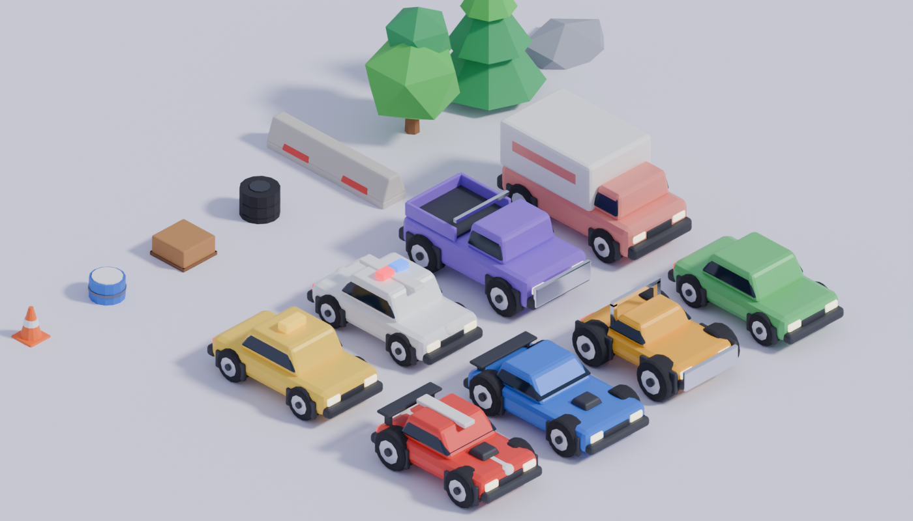

# Mochi Pet

Um cozy pet game mobile no estilo Pou, com bichinhos de gelatina brilhante. Roda direto no navegador, sem build e sem dependências.

## Como jogar

- **Cozinha**: arraste a comida até a boquinha (ou toque nela para dar). Cada comida custa moedas.
- **Banho**: esfregue o sabonete no bichinho e depois segure o chuveiro para enxaguar a espuma.
- **Quarto**: apague a luz para ele dormir e recarregar a energia.
- **Brincar**: arremesse a bolinha nele ou jogue a **Chuva de Doces** para ganhar moedas.
- **Closet**: troque de bichinho (Mochi, Coelho, Gato), compre cores e acessórios.

Toque no bichinho para cutucar, arraste o dedo em cima dele para fazer carinho. Se cutucar demais ele fica tonto.
As necessidades (fome, energia, diversão, higiene) caem com o tempo, e o progresso fica salvo no navegador.

## Rodando

Sirva a pasta com qualquer servidor estático (o renderizador 3D usa módulos ES, que não carregam via `file://`; nesse caso o jogo cai para a versão 2D):

```sh
npx http-server .
```

No celular, acesse o endereço da sua máquina na rede local (ou publique no GitHub Pages) e use "Adicionar à tela de início" para jogar em tela cheia.

## Estrutura

- `index.html`: estrutura da interface
- `style.css`: visual da interface
- `game.js`: lógica do jogo, física de molas para squash & stretch, cômodos, minigame, sons sintetizados com Web Audio e renderização 2D (cenário, partículas, ícones e fallback do bichinho)
- `pet3d.js`: bichinho em 3D com Three.js. Corpos gerados por revolução do contorno de cada espécie e um `ShaderMaterial` "jelly" próprio:
  - vertex shader: balanço de gelatina (o topo atrasa em relação à base) e ondulação que se espalha a partir do toque
  - fragment shader: gradiente de altura, subsurface/translucidez falsos, fresnel, reflexos de estúdio e o rosto projetado na superfície (desenhado num canvas e usado como textura, então todas as expressões animam)
- `vendor/three.module.min.js`: Three.js r160 (MIT), embutido para funcionar offline; se faltar, carrega da CDN

---

# Gramado Estelar

Minigolfe isométrico em pixel art, flutuando num céu de pôr do sol, inspirado em Kirby's Dream Course, com personagens próprios. Fica na pasta [`estelar/`](estelar/).

## Como jogar

- Arraste para trás e solte para tacar. A linha pontilhada mostra o começo do caminho.
- Derrube todos os inimigos. O último vira o buraco, e aí é só acertar a bola nele.
- **Pulo**: liga a tacada aérea, para passar por vãos, água e acertar inimigos voadores.
- Durante a rolagem, segure para frear. Se tiver uma habilidade, toque para usá-la:
  - **Rocha**: para na hora.
  - **Turbo**: dá uma arrancada.
  - **Mola**: dá um quique alto.
- Ouriços não podem ser derrotados e rebatem a bola. Água e vãos custam uma tacada.
- Personagens: Pipo (equilibrado), Brasa (força), Nimbo (pulo) e Musgo (controle).
- 6 buracos com rampas, areia, gelo, setas de turbo e rebatedores.

Teclado: `J` liga o pulo, espaço freia ou usa a habilidade, `Esc` pausa.

## Estrutura

- `estelar/holes.js`: os buracos, descritos como mapas de texto (tipo de piso + altura por casa)
- `estelar/game.js`: física isométrica com alturas e rampas, renderização em baixa resolução ampliada sem suavização, sprites gerados por código (personagens e inimigos são esferas iluminadas rasterizadas pixel a pixel, por isso rolam de verdade), música chiptune e efeitos sintetizados com Web Audio

---

# Mini Fúria

Corrida isométrica 3D de mini carros no estilo "arcade de batidas": turbo, drift, takedowns nos rivais, quase-batidas no trânsito e capotagens em câmera lenta. Fica na pasta [`turbo/`](turbo/) (abra `turbo/index.html` por um servidor estático).



## Como jogar

- **Celular**: arraste no lado esquerdo da tela para apontar a direção (relativa à tela). O carro acelera sozinho. À direita ficam **TURBO**, **DRIFT** e **FREIO** (segurar o freio parado dá ré).
- **Teclado**: setas/WASD, `Espaço` drift, `Shift` turbo, `R` volta para a pista, `P` pausa, `M` som.
- **Turbo**: enche com drift, quase-batidas no trânsito, andar na contramão, pulos nas rampas, boost pads e destruir cones/barris/caixotes.
- **Takedown**: bata forte nos rivais ou jogue eles no muro. Enche o turbo inteiro, com câmera lenta.
- **Batida**: bater de frente no muro ou no trânsito capota o carro. Depois de um instante você volta para a pista, piscando e invulnerável.
- 3 voltas contra 3 rivais (com rubber band), 16 carros de trânsito nos dois sentidos.

## Game juice

Hitstop nas batidas, câmera lenta com dessaturação nos takedowns e capotagens, tremor de câmera por trauma, zoom que abre com a velocidade e dá um "soco" no turbo, blur radial e aberração cromática no turbo, bloom nos faróis e lanternas, chamas no escapamento, rastro das lanternas, linhas de velocidade, fumaça de pneu, marcas de pneu persistentes, faíscas raspando no muro, poeira nos pousos, destroços e rodas que se soltam, confete nas voltas, suspensão com molas (rolagem, arfagem, squash no pouso), rodas que giram e contra-esterçam no drift, motor sintetizado com troca de marchas e popups animados.

## Estrutura

- `turbo/blender/build_assets.py`: modela todos os carros (Faísca, Trovão, Vespa, sedã, táxi, polícia, picape, van) e props (cones, barris, caixotes, pneus, barreiras, árvores, pinheiros, pedras, postes, prédios, rampa, portal de largada, arquibancada, destroços) via `bpy` e exporta `turbo/assets/minicars.glb`. Roda com `blender -b -P build_assets.py` ou `pip install bpy && python build_assets.py --render preview.png`.
- `turbo/js/track.js`: pista como spline fechada, malhas (asfalto, zebras, muros), rampas, boost pads, colisão com muros num grid espacial e texturas procedurais.
- `turbo/js/car.js`: física arcade (aderência lateral, drift que conserva embalo, turbo, guinada, rampas/pulos), impulsos com rotação, capotagem 3D com quaternion, visual com suspensão e IA (rivais com faixas, frenagem antes das curvas, turbo nas retas e agressividade; trânsito nos dois sentidos).
- `turbo/js/fx.js`: partículas com shader próprio, fitas (marcas de pneu, rastros, linhas de velocidade), destroços, tremor de câmera e pós-processamento (bloom + shader final).
- `turbo/js/audio.js`: sons sintetizados com Web Audio.
- `turbo/js/input.js`: teclado e controles touch.
- `turbo/js/main.js`: mundo, colisões, regras (takedown, quase-batida, contramão, voltas, posições), câmera isométrica, HUD e minimapa.
- `vendor/jsm/`: addons do Three.js r160 (GLTFLoader e pós-processamento), MIT.

Para testes automatizados existe `window.__game.advance(segundos)`, que simula sem renderizar.
