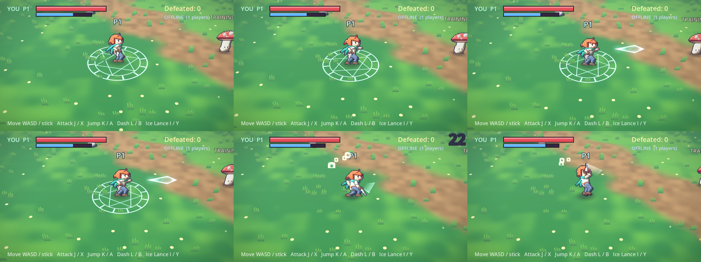

# Aurelia — co-op action RPG (Godot 4.4)

Open-world-ready action RPG inspired by *Legend of Mana*: small, well-animated pixel heroes on an HD-2D
stage, approach-and-hit melee combos, movement skills, weapons, spells, **online co-op** (up to 4), and a lot of juice.

This is **milestone 1**: one hero (*Ren*), one test stage (the *Glade of Aurel*), one enemy (*Capmook*, plus a
training dummy), one weapon (Bronze Sword, 3-hit combo) and one spell (**Ice Lance**).



## Run it

Open `aurelia/` in Godot **4.4+** (Compatibility renderer) and press F5.
Title screen: **Solo**, **Host co-op game**, or **Join** an IP (ENet, UDP port 24565).

| Action | Keyboard | Gamepad |
|---|---|---|
| Move | WASD / arrows | left stick |
| Attack (tap for a 3-hit combo) | J / Z | X |
| Jump | K / Space | A |
| Dash (i-frames, cancels attack recovery) | L / Shift | B |
| Ice Lance (20 MP) | I / C | Y |

### Tablet / phone (touch) and HTML5

Touch controls appear automatically on touch devices (or with `-- --touch`, where the mouse acts as a finger):
a floating stick on the left half of the screen, **ATK / JMP / DSH / ICE** buttons on the right, **MENU** top-right.
They feed the same input actions as keyboard/gamepad, and multi-touch works (move + attack at once).

The HTML5 build is **solo only** (browsers cannot open UDP sockets, so ENet co-op needs the desktop build) and
uses a lighter quality preset (less grass, shorter shadows). It is exported single-threaded, so any static
host works (no special COOP/COEP headers).

```sh
aurelia/tools/serve_web.sh          # export + serve on your LAN -> open http://<your-ip>:8060/ on the tablet
```

Needs Godot 4.4.1 with its **Web export templates** installed (Editor → Manage Export Templates).
Tips: on iPad add the page to the Home Screen for fullscreen; sound starts after your first tap.

Command-line shortcuts: `-- --solo`, `-- --host`, `-- --join=127.0.0.1` (everything after `--` goes to the game).

## Tests

```sh
godot --headless --path aurelia --import                  # once, on a fresh clone
godot --headless --path aurelia res://tests/run_all.tscn  # unit checks (contracts, data, combat math, stage)
godot --headless --path aurelia -- --solo --autotest      # a scripted bot plays: combo, dash, jump, spell, kills
aurelia/tests/net_smoke.sh                                # host + client processes over ENet, both see 2 players
python3 aurelia/tools/qa.py                               # art QA gate (contracts, fluidity, pixel hygiene)
```

Screenshots with a software GL stack: `xvfb-run -a godot --rendering-driver opengl3 --path aurelia -- --solo --autotest --showcase --shot=/tmp/shots --shot_ticks=60,72,128`.

## How the art works (Python, no drawing program)

`tools/spritegen/` follows the pipeline from the GRAYFALL write-up: a pose is a dict of angles (`lean`, hands,
feet, sword angle…) → 2-bone IK places elbows/knees → shapes (capsules, ribbons, Catmull-Rom) are rasterised at
**4x** into material/tone/part buffers → **cel shading by mask offset** (5 tones per material, light from the
upper-left) → **majority-vote downsample** (crisp pixels, no AA) → dark seams only where different parts touch →
1 px outline → the **face is painted after downsampling** → **normal maps are generated** (the 3D stage lights the
billboard) → hair/scarf are **spring chains** simulated per frame, never keyed.

```sh
python3 aurelia/tools/spritegen/build.py          # regenerates art/chars/{ren,capmook}/ (sheet, normal, sheet.json, contact.png)
python3 aurelia/tools/qa.py                       # the gate: fails the build if the art breaks the contract
python3 aurelia/tools/sfxgen.py                   # procedural placeholder SFX -> art/sfx/
```

**Frozen contracts** live in `art/contracts/*.contract.json`: animation names, logical frames, ticks per frame,
contact frames. The renderer may redraw everything and add sub-frames; it may not change the contract, so
gameplay keeps indexing "frame 2 of `sword.1`" and lands the same hit. Sub-frames are visual-only (picked in
`core/anim_sheet.gd`; the game never reads them). Every frame exports **anchors** (hand, weapon_tip, off_hand,
head, chest) used by weapon trails, projectiles and VFX.

Ren is 46 px tall in a 64x64 cell (chibi, ~2.6 heads — close to Legend of Mana's sprite scale); one facing is drawn
(3/4 right) and mirrored in-engine. The camera is set so one sprite pixel ≈ 4 screen pixels at 720p.

Adding a character: write `art/contracts/<id>.contract.json`, a `tools/spritegen/chars/<id>.py` (poses, skeleton, draw),
run `build.py` + `qa.py`. Rule of thumb from the post: describe each ability as a *drawable noun* (ice lance, comet,
ring of fire), keep big VFX shapes **hollow** (additive blending blows solid cores to white), and give launchers an
explicit launch height in px (`AttackData.launch_height_px`).

## Code map

| Path | What |
|---|---|
| `autoload/` | `Game` (ticks, event log), `Registry` (loads `data/**/*.tres`), `Juice` (game feel), `Sfx`, `Net` (ENet), `InputRouter` |
| `core/` | `AnimSheet` (contract runtime), `SpriteActor` (billboard + squash/flash/afterimage), `InputFrame`/`InputSource` |
| `combat/` | data resources `AttackData`, `WeaponData`, `SpellData`, `EnemyData` + `Combat` helpers |
| `actors/` | `Player` (tick state machine: idle/dash/jump/attack/cast/hurt/dead), `Enemy` (host-side brain) |
| `world/` | `World` (spawning, RPCs), `StageBuilder` (procedural glade) |
| `vfx/` | shaders (billboard+normal map, hollow ice shell, magic circle, rings, sparks, grass, water, tilt-shift), `WeaponTrail`, `IceLance` |
| `data/` | `.tres` files — **a new weapon/spell/enemy is one file plus art** |

### Combat model
Everything gameplay-side counts integer ticks at 60/s. An attack's active window *is* the contract's contact frame
(held ≥ 6 ticks so hits land instead of sliding). Input is buffered 8 ticks; combos advance when attack was pressed
and the contact frame is over; dash cancels attack recovery. Hitstop is a per-entity tick freeze (never
`Engine.time_scale`), so networking stays sane.

### Multiplayer model
Listen-server over ENet. Each client is authoritative for its own movement and detects its own hits (feels instant:
hitstop/shake/sparks play immediately); the host validates (`plausibility check`), owns enemies and HP, and
broadcasts damage numbers/effects. Enemies simulate on the host and replicate through `MultiplayerSynchronizer`;
players/enemies/spells spawn through RPCs with identical node paths. Input is abstracted (`InputSource`) so local
co-op can be added by giving one peer several sources (`Player.local_index`).

### Juice inventory
Hitstop · trauma shake · camera kick + FOV punch + chromatic pulse · squash & stretch springs · hit flash ·
3D weapon ribbon trail from the `weapon_tip` anchor · star-shaped sparks + hollow impact rings + flash light ·
damage numbers (crits bigger/gold) · dust & dash rings · dash afterimages · pixel-dissolve death with burst ·
telegraph glow on enemy windup · Ice Lance (hexagonal crystal shell shader, rotating rune circle, frost motes,
shard burst) · tilt-shift + vignette post pass · rumble · procedural SFX with pitch jitter.

## Blender path (not used yet)
The stage is generated from primitives so it needs no imported assets. To swap in Blender-made scenery: export
`.glb` into `assets/models/`, instance it in `world/stage_builder.gd` in place of a generator, and name collision
meshes with a `-col` suffix (Godot imports those as static colliders).

## Not in milestone 1
Back-facing sprites (so up/down movement reuses the same side-facing frames), more weapons/spells/enemies,
streaming of neighbouring world chunks (`World` is built around one chunk), local split co-op, NAT traversal/lobby,
saves, loot. Planning notes: `docs/PLAN.md`.
