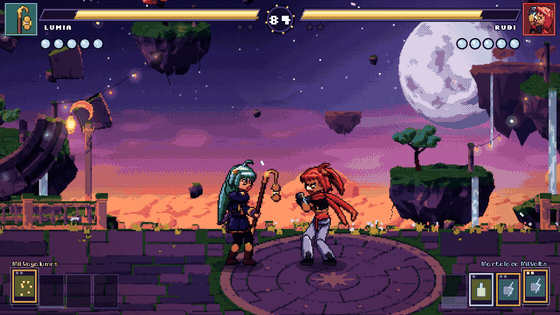
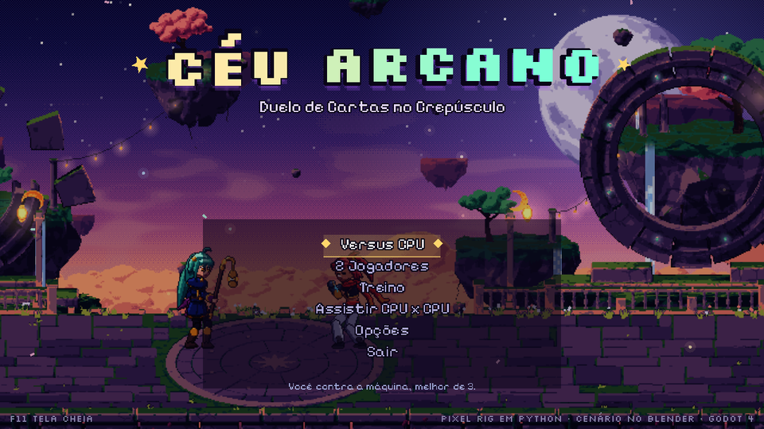
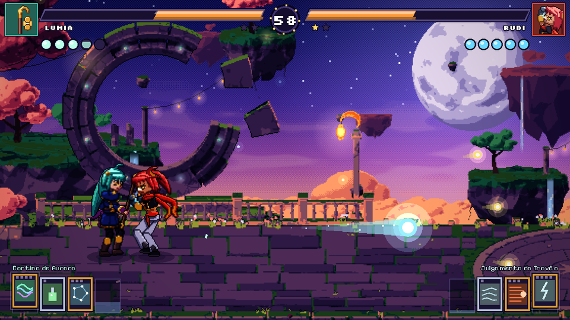
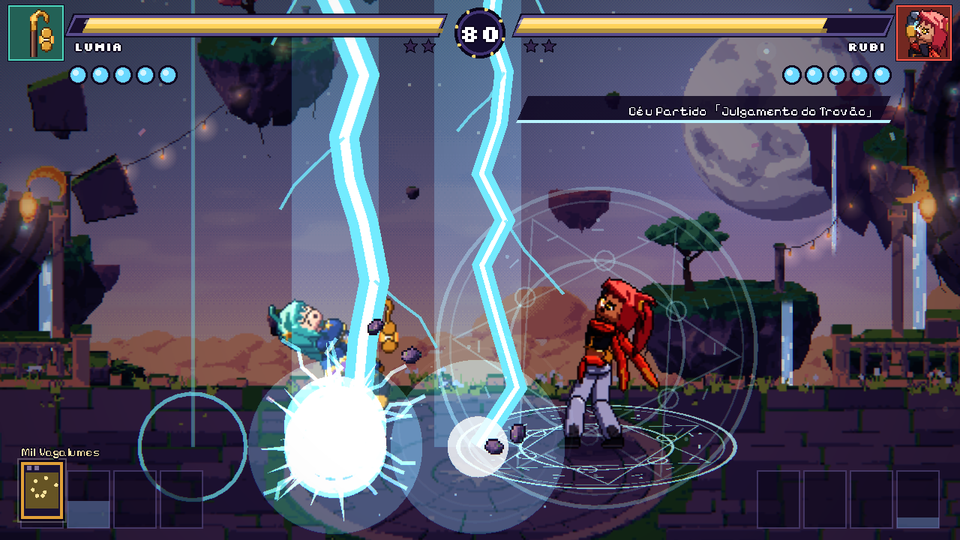

# Céu Arcano

*Duelo de Cartas no Crepúsculo.* Jogo de luta 2D em pixel art no estilo bullet-hell fighter: duas duelistas
se enfrentam com golpes, tiros de magia, voo e **cartas de feitiço** declaradas com cut-in. É um jogo
original, com personagens, cenário, músicas e efeitos próprios.



| | |
|---|---|
|  |  |
|  | |

## Como jogar

Abra `game/project.godot` no **Godot 4.5** (ou mais novo) e aperte F5. Também roda direto pela linha de comando:

```sh
godot --path ceu-arcano/game
```

Modos: Versus CPU (melhor de 3), 2 Jogadores, Treino (boneco parado, espírito e cartas infinitos) e CPU x CPU.

### Controles

| Ação | Jogador 1 | Jogador 2 | Controle |
|---|---|---|---|
| Mover / pular / agachar | A D / W / S | setas | direcional ou analógico |
| Golpe (A) | J | Num1 ou `,` | X |
| Tiro (B) | K | Num2 ou `.` | Y |
| Habilidade (C) | L | Num3 ou `/` | B |
| Dash / voo | Espaço ou Shift | Num0 ou Ctrl | A ou RB |
| Usar carta | I | Num5 ou `;` | LB |
| Trocar carta | O | Num6 ou `'` | Back |
| Pausa | Esc | Backspace | Start |

F11 alterna tela cheia. F1 mostra as caixas de colisão (hitbox em vermelho, hurtbox em azul).

### Sistema de luta

- **Golpes**: J quatro vezes faz a sequência completa. Para frente+J é o golpe forte, baixo+J é rasteiro
  (tem que defender agachado), J no ar e baixo+J no ar (tem que defender em pé).
- **Tiros e habilidades** gastam **espírito** (os 5 orbes azuis). Ele recarrega sozinho depois de um tempinho.
  Cada habilidade tem três versões: neutra, para frente e para baixo, e uma no ar.
- **Defesa**: segure para trás. Defender também gasta espírito. Se zerar, a guarda **quebra** e você fica tonta.
- **Graze**: dash e voo atravessam tiros. Cada tiro raspado enche o medidor de cartas.
- **Voo**: dash no ar voa na direção segurada (8 direções), gastando espírito.
- **Cartas**: acertar, apanhar e dar graze enchem o medidor. Cheio, você compra uma carta do deck (mão de até 4).
  A carta da esquerda é a ativa. Ela custa de 1 a 4 cartas da mão: com cartas suficientes, I declara o feitiço.
  Cartas de **sistema** (Elixir, Vento Favorável) têm efeito na hora.
- **Combos** perdem dano aos poucos (proration) e têm um limite. Golpes fortes lançam, quicam na parede e no chão.
- **Contra-ataque**: acertar alguém no meio de um golpe dá dano e atordoamento extras.
- **Clima**: cada round muda o céu e uma regra. Crepúsculo é neutro, na Chuva de Estrelas as cartas enchem
  50% mais rápido e na Aurora o espírito recarrega 50% mais rápido.

### As duelistas

**Lumia, a Bruxa dos Vagalumes** (zoneadora). Luta com um cajado de lanterna.
- Habilidades: Lanterna Flutuante (torre que atira sozinha), Cometa (atravessa tiros fracos) e Mariposas (anti-aéreo teleguiado).
- Cartas: *Sinal Vagalume 「Mil Vagalumes」* (custa 2), *Carta Celeste 「Constelação Cartográfica」* (custa 3)
  e *Crepúsculo 「Cortina de Aurora」* (custa 4).

**Rubi, a Lutadora da Tempestade** (ofensiva). Usa manoplas elétricas.
- Habilidades: Esfera Elétrica (multi-hit que come tiros), Investida Trovão (atravessa tiros) e Gancho Ascendente (invencível no começo).
- Cartas: *Punho Trovão 「Martelo de Mil Volts」* (custa 2), *Vendaval 「Mil Golpes da Tormenta」* (custa 3)
  e *Céu Partido 「Julgamento do Trovão」* (custa 4).

## Pipeline de assets

Tudo é gerado por código e pode ser refeito com `python3 pipeline/build_all.py` (ou só uma etapa:
`chars`, `stage`, `audio`). O contrato entre as etapas e o jogo está em
[`pipeline/ASSET_SPEC.md`](pipeline/ASSET_SPEC.md).

### Personagens: rig de pixel art em Python (`pipeline/pixelrig`, `pipeline/characters`)

Em vez de desenhar quadro a quadro, cada personagem é um **boneco vetorial que vira pixel art em cada quadro**:

1. **Formas por SDF** (`pixelrig/shapes.py`). Cada parte do corpo é um conjunto de funções de distância com sinal:
   círculos, elipses, cápsulas afuniladas, polígonos arredondados por Chaikin e fitas. Elas são avaliadas no centro
   de cada pixel, já transformadas pelo osso, então qualquer rotação sai limpa, sem os borrões de girar sprite.
2. **Sombreamento quantizado** (`pixelrig/raster.py`). A distância à borda vira uma "almofada" 3D, a normal vem
   do gradiente e a luz é quantizada numa rampa de 5 cores por material: contorno, sombra, base, luz e brilho.
   Depois o compositor aplica sombra projetada das partes da frente, contorno interno seletivo onde uma parte
   cobre outra, contorno colorido da silhueta e limpeza de pixels órfãos. Tudo fica num buffer indexado, então
   a paleta alternativa (para luta espelhada) sai de graça.
3. **Esqueleto com IK** (`pixelrig/rig.py`). 18 ossos, pés com IK de dois ossos (o quadril sobe e desce e os pés
   ficam plantados) e ângulos no mundo para os objetos (`staff.w`).
4. **Física secundária**. Cabelo, rabo de cavalo, cachecol, laços, faixa da cintura e a lanterna pendurada no
   cajado são correntes Verlet simuladas a 60 fps durante o bake, com vento por animação. É daí que vem o
   movimento atrasado e fluido.
5. **Animação por keyframes com easing** (`pixelrig/bake.py`), amostrada a cada 2–4 frames de jogo e sempre nos
   frames de hitbox e de evento. Golpes geram **rastros (smears)** a partir do caminho real da arma.
6. **Dados de luta automáticos**. Hurtboxes saem dos pixels de cada grupo de partes (cabeça, corpo, pernas e
   braços quando atacam), hitboxes vêm de círculos presos aos ossos, e o bake também exporta pontos de âncora
   (ponta do cajado, mãos) e eventos (`fire`, `skill`, `burst`).
7. **Atlas**. Os quadros são recortados, deduplicados e empacotados num atlas de 2048×2048 por paleta, mais um
   JSON com retângulos, origem, duração em frames, caixas e eventos.

```sh
python3 pipeline/characters/build_characters.py          # as duas, cerca de 40 s
python3 pipeline/characters/preview.py lumia a6 saida.png # folha de uma animação, para revisar
python3 pipeline/characters/preview.py rubi stance x.png --alt
```

Para criar uma animação, adicione um `Anim(...)` em `characters/anims_<id>.py` com poses
(`P(STANCE, sh_f=-90, el_f=-4, ...)`), hitboxes (`Hit(t0, t1, osso, offset, raio)`) e eventos. No Godot, o
golpe é uma linha na tabela de `game/scripts/battle/kit_<id>.gd`.

### Cenário: Blender (`pipeline/blender`)

`build_stage.py` usa o Blender como módulo Python (`pip install bpy`) e monta o *Jardim das Lanternas Suspensas*
de forma procedural: ilhas flutuantes, árvores em flor, portais circulares de pedra, terraço, balaústres,
cordões de lanternas e mar de nuvens. Cada camada de parallax (far, mid, near, ground, fg) é renderizada no Cycles
com câmera ortográfica, no tamanho exato em pixels, em duas passadas: ID de material e luz. O `pixelize.py`
mapeia a luz em rampas de uma paleta curada de 45 cores, aplica perspectiva atmosférica e contorno e limpa o
ruído. O `stage.json` traz as camadas e a posição projetada de cada lanterna e cachoeira, que o Godot usa para
pôr brilhos tremulando e água animada. `build_vfx.py` renderiza os sprites 3D girando (estrela, lanterna e pedras).

### Áudio (`pipeline/audio`)

Síntese em numpy: osciladores band-limited, FM, filtros, reverb e compressor. Saem 43 efeitos e 4 músicas
(título, seleção, batalha a 165 BPM e fanfarra de vitória) em loop sem emenda, a -14 LUFS.

## Estrutura do jogo (`game/`)

| Arquivo | O que faz |
|---|---|
| `scripts/battle/battle.gd` | loop fixo de 60 ticks, hitstop, super freeze, colisões, rounds, KO em câmera lenta, câmera dinâmica |
| `scripts/battle/fighter.gd` | máquina de estados do lutador, física, espírito, cartas, defesa, quebra de guarda |
| `scripts/battle/kit_lumia.gd`, `kit_rubi.gd` | tabela de golpes, projéteis e roteiro das cartas de feitiço |
| `scripts/battle/projectile.gd` | projéteis: teleguiados, feixes, raios, colisão entre tiros e graze |
| `scripts/battle/fx.gd` | faíscas, partículas, anéis, pós-imagens, poeira e textos |
| `scripts/battle/hud.gd` | vida com barra fantasma, orbes, mão de cartas animada, combo, timer e anúncios |
| `scripts/battle/cutin.gd`, `spell_bg.gd` | cut-in da declaração e círculo mágico |
| `scripts/battle/stage.gd` | camadas do Blender com parallax e zoom por profundidade, céu em shader, vagalumes e pétalas |
| `scripts/battle/ai.gd` | CPU com estilo por personagem, defesa com reação e combos |
| `shaders/` | filtro *pixel AA* (pixel art nítida em qualquer zoom), céu, onda de choque, aberração e aurora |

Game juice: hitstop por força do golpe, tremor da vítima, flash branco (laranja no contra-ataque), screen shake
por trauma, soco de zoom, onda de choque e aberração cromática nos golpes pesados, câmera lenta e dessaturação
no K.O., pós-imagens em dash e voo, poeira, detritos 3D, quique na parede e no chão, cartas voando para a mão,
barra de vida fantasma e contador de combo que pulsa.

## Testes

```sh
cd ceu-arcano/game
godot --headless res://tests/check.tscn               # compila todos os scripts
godot --headless --fixed-fps 60 res://tests/input_test.tscn -- --char=rubi   # simula o jogador 1 (16 ações)
xvfb-run godot res://tests/autoplay.tscn -- --out=/tmp/shots --total=3600   # CPU x CPU com capturas
xvfb-run godot res://tests/showcase.tscn -- --out=/tmp/spells               # todas as cartas de feitiço
```

## Exportar

`export_presets.cfg` já tem Linux, Windows e Web (os `.json` entram no pacote). Instale os export templates
do Godot 4.5 e use *Projeto → Exportar*.

## Créditos

Fontes [Pixelify Sans](https://fonts.google.com/specimen/Pixelify+Sans) e
[Silkscreen](https://fonts.google.com/specimen/Silkscreen), licença SIL OFL (em `game/assets/fonts`).
Todo o resto (arte, animação, música e efeitos) é gerado pelos scripts deste repositório.
