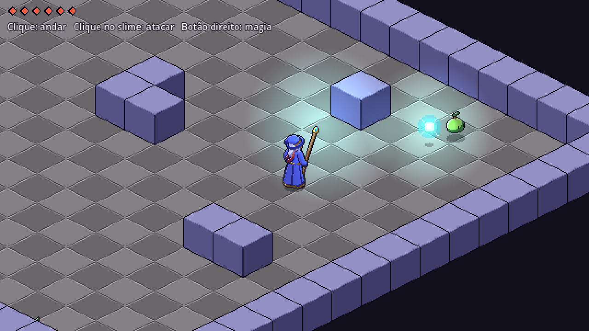

# Vesper: RPG isométrico (MVP)

Protótipo de RPG de ação isométrico em Godot 4.7 (feito para PC). Os sprites não foram desenhados à mão: são gerados por código Python, seguindo o pipeline do GRAYFALL.



Todas as animações do mago (S, E, N, O e SE): [docs/contact_mage.png](docs/contact_mage.png)

## Como jogar

- **Clique esquerdo no chão**: andar. Segurar o botão faz o personagem seguir o cursor.
- **Clique esquerdo num slime**: o mago anda até ficar no alcance e ataca até o slime morrer.
- **Clique direito**: lança a magia na direção do cursor.
- No celular (versão web), toque para andar e toque no slime para atacar.
- Abrir com `?demo` na URL (ou `--demo` na linha de comando) faz o mago lutar sozinho, para testar.

O mago tem 6 de vida. Os slimes perseguem quando você chega perto e reaparecem depois de alguns segundos.

## Estrutura

```
isorpg/
  project.godot, export_presets.cfg   projeto Godot (renderer Compatibility, roda na web)
  scenes/main.tscn                    só a raiz, o resto é montado em código
  scripts/
    main.gd          mapa de teste (texto), A* em AStarGrid2D, input, câmera, partículas
    gen_sprite.gd    toca as sheets geradas, emite eventos por frame lógico
    player.gd        mago: andar, conjurar, levar dano, morrer e renascer
    slime.gd         inimigo de teste
    bolt.gd          projétil arcano com luz própria
    iso.gd           conversão grid <-> tela 2:1 e direção (8)
  assets/gen/        tudo aqui é gerado pelo tools/spritegen, não edite à mão
  tools/spritegen/   o pipeline de sprites
  docs/              contact sheets para revisar a olho
```

## Pipeline de sprites (tools/spritegen)

Só usa Python, Pillow e numpy.

```sh
cd isorpg/tools/spritegen
python3 build.py          # renderiza mago, slime, tiles e fx
python3 qa_hero.py        # gate de qualidade
```

Como um frame é feito:

1. **A pose é um dicionário** (`mage.py`) com `lean`, `twist`, `roll`, ângulos da cabeça, alvos de mão e pé, direção do cajado e expressão. IK de dois ossos (`rig.py`) posiciona cotovelos e joelhos.
2. **O esqueleto é 3D**, então as 8 direções saem da mesma pose: basta girar o personagem e projetar com a câmera isométrica a 30° (a mesma de um grid 2:1).
3. **Rasterização em 4x** (`raster.py`): cápsulas, esferas e superfícies (manto, chapéu, cristal) escrevem num z-buffer por parte, junto com a normal.
4. **Cel shading por deslocamento de máscara**: desloca-se a máscara da parte em direção à luz e a faixa descoberta desce um tom. Um deslocamento mais longo dá o tom profundo, e o deslocamento oposto dá o brilho. As partes também projetam sombra no que está atrás delas.
5. **Downsample por voto de maioria** em blocos 4x4 (chave parte+tom), sem média e sem anti-aliasing. Partes finas (cajado) têm peso de voto maior.
6. **Linhas internas** só onde dois grupos diferentes se encostam, desenhadas na parte de trás.
7. **Contorno de 1 px** em volta do corpo.
8. **Rosto pintado depois do downsample**, pixel a pixel, para não virar borrão no voto.
9. **Normal map gerado** (`*_n.png`): na Godot, a luz do cristal do cajado e a do projétil iluminam o sprite através dele.
10. **Molas**: ponta do chapéu, cabelo, as duas pontas do cachecol e a barra do manto são cadeias simuladas por tick. O movimento secundário não é animado à mão.
11. **Frames lógicos vs sub-frames**: o contrato (`contracts/*.json`) congela nomes, quantidade de frames lógicos e ticks. O renderer pode mudar tudo, inclusive acrescentar sub-frames, mas não o contrato. O evento `release` do `cast` (que dispara o projétil) fica num frame lógico.
12. **Âncoras** por frame (`staff_tip`, mãos, cabeça, peito): o projétil e a luz saem da ponta do cajado em qualquer direção.

Animações do mago: `idle`, `walk`, `cast`, `hurt` e `death`, cada uma em 8 direções.

## Rodando

- **Editor**: abra `isorpg/project.godot` na Godot 4.7 e aperte F5.
- **Web**: `godot --headless --export-release Web build/web/index.html` (precisa dos templates `web_nothreads`). `tools/web/pack_gz.py` comprime o `.wasm` para hospedagem com limite de tamanho de arquivo.
- **PC**: os presets "Windows Desktop" e "Linux" já estão no `export_presets.cfg`.
