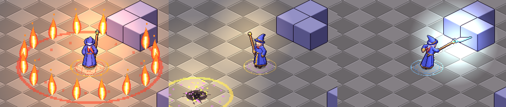

# Vesper: RPG isométrico (MVP)

Protótipo de RPG de ação isométrico em Godot 4.7 (feito para PC). Os sprites não foram desenhados à mão: são gerados por código Python, seguindo o pipeline do GRAYFALL.


Todas as animações do mago (S, E, N, O e SE): [docs/contact_mage.png](docs/contact_mage.png)

## Magias



| Tecla | Magia | Animação do mago | Efeito |
|---|---|---|---|
| 1 / Q | Seta Arcana | `cast` | projétil teleguiado, 1 de dano. É o ataque do clique no slime |
| 2 / W | Cometa | `summon`: ergue o cajado com as duas mãos e crava o cristal no chão | marca o alvo com uma runa; o cometa cai, deixa cratera e onda de choque. 3 de dano em área com empurrão |
| 3 / E | Anel de Fogo | `spin`: giro de 360° com o cajado estendido | anel de 16 pilares de chama que se expande a partir do mago. 2 de dano e empurrão forte |
| 4 / R | Lança de Gelo | `thrust`: estocada a duas mãos | lança de cristal que atravessa a linha inteira. 2 de dano e congela por 2,6 s |

- Acertar um inimigo **congelado** estilhaça o gelo e causa +1 de dano. Combo: Lança de Gelo e depois Cometa.
- No PC, a tecla lança a magia na posição do cursor.

### Controles de toque (celular/tablet)

Aparecem sozinhos no primeiro toque, ou desde o início em telas de toque.

- **Toque no chão**: andar. **Segure**: o mago segue o dedo.
- **Toque num slime**: atacar com a Seta Arcana até ele morrer.
- **Botões de magia** em arco no canto inferior direito (o maior é a Seta Arcana):
  - **toque rápido** = mira automática no slime mais próximo ao alcance;
  - **segure e arraste** = mira manual, com prévia no chão (linha, área do Cometa, raio do Anel de Fogo). A distância do arraste controla o alcance. Solte para lançar.
- **Multitoque**: um polegar segura o chão para andar enquanto o outro lança magias.
- **AUTO** (canto superior direito): o mago luta sozinho e usa todas as magias. **LENTO**: câmera lenta para ver as animações.
- Cada magia tem seu próprio círculo rúnico sob os pés e uma luz na cor do elemento, que ilumina o mago pelo normal map.
- O efeito começa no evento `release` da animação, um frame lógico congelado no contrato.

## Como jogar

- **Clique esquerdo no chão**: andar. Segurar o botão faz o personagem seguir o cursor.
- **Clique esquerdo num slime**: o mago anda até ficar no alcance e ataca até o slime morrer.
- **1-4 ou Q W E R**: magias (veja acima). **Clique direito**: lança a magia armada, ou a Seta Arcana.
- No celular (versão web), veja **Controles de toque** acima.
- Abrir com `?demo` ou `#demo` na URL (e `#slow` para câmera lenta) (ou `--demo` na linha de comando) faz o mago lutar sozinho, para testar.

O mago tem 6 de vida. Os slimes perseguem quando você chega perto e reaparecem depois de alguns segundos.

## Estrutura

```
isorpg/
  project.godot, export_presets.cfg   projeto Godot (renderer Compatibility, roda na web)
  scenes/main.tscn                    só a raiz, o resto é montado em código
  scripts/
    main.gd          mapa de teste (texto), A* em AStarGrid2D, input, câmera, partículas
    gen_sprite.gd    toca as sheets geradas, emite eventos por frame lógico
    player.gd        mago: andar, conjurar, levar dano, morrer e renascer
    slime.gd         inimigo de teste
    spells.gd        grimório: tecla, animação, recarga, alcance, cor e runa de cada magia
    bolt.gd          Seta Arcana
    comet.gd         Cometa
    fire_ring.gd     Anel de Fogo
    ice_lance.gd     Lança de Gelo
    fx_anim.gd, damage_number.gd   efeitos de uma vez só e números de dano em pixel
    aim_layer.gd     prévia de mira no chão enquanto se arrasta um botão de magia
    iso.gd           conversão grid <-> tela 2:1 e direção (8)
  assets/gen/        tudo aqui é gerado pelo tools/spritegen, não edite à mão
  tools/spritegen/   o pipeline de sprites
  docs/              contact sheets para revisar a olho
```

## Pipeline de sprites (tools/spritegen)

Só usa Python, Pillow e numpy.

```sh
cd isorpg/tools/spritegen
python3 build.py          # renderiza mago, slime, tiles e fx
python3 fx.py             # só os efeitos das magias (rápido)
python3 qa_hero.py        # gate de qualidade
```

Como um frame é feito:

1. **A pose é um dicionário** (`mage.py`) com `lean`, `twist`, `roll`, ângulos da cabeça, alvos de mão e pé, direção do cajado e expressão. IK de dois ossos (`rig.py`) posiciona cotovelos e joelhos.
2. **O esqueleto é 3D**, então as 8 direções saem da mesma pose: basta girar o personagem e projetar com a câmera isométrica a 30° (a mesma de um grid 2:1).
3. **Rasterização em 4x** (`raster.py`): cápsulas, esferas e superfícies (manto, chapéu, cristal) escrevem num z-buffer por parte, junto com a normal.
4. **Cel shading por deslocamento de máscara**: desloca-se a máscara da parte em direção à luz e a faixa descoberta desce um tom. Um deslocamento mais longo dá o tom profundo, e o deslocamento oposto dá o brilho. As partes também projetam sombra no que está atrás delas.
5. **Downsample por voto de maioria** em blocos 4x4 (chave parte+tom), sem média e sem anti-aliasing. Partes finas (cajado) têm peso de voto maior.
6. **Linhas internas** só onde dois grupos diferentes se encostam, desenhadas na parte de trás.
7. **Contorno de 1 px** em volta do corpo.
8. **Rosto pintado depois do downsample**, pixel a pixel, para não virar borrão no voto.
9. **Normal map gerado** (`*_n.png`): na Godot, a luz do cristal do cajado e a do projétil iluminam o sprite através dele.
10. **Molas**: ponta do chapéu, cabelo, as duas pontas do cachecol e a barra do manto são cadeias simuladas por tick. O movimento secundário não é animado à mão.
11. **Frames lógicos vs sub-frames**: o contrato (`contracts/*.json`) congela nomes, quantidade de frames lógicos e ticks. O renderer pode mudar tudo, inclusive acrescentar sub-frames, mas não o contrato. O evento `release` do `cast` (que dispara o projétil) fica num frame lógico.
12. **Âncoras** por frame (`staff_tip`, mãos, cabeça, peito): o projétil e a luz saem da ponta do cajado em qualquer direção.

Animações do mago: `idle`, `walk`, `cast`, `summon`, `spin`, `thrust`, `hurt` e `death`, cada uma em 8 direções. A pose aceita `yaw` (giro do corpo inteiro) e `lgrip`/`lgrip_w` (mão esquerda presa ao cajado).

Os efeitos (`fx.py`) também são objetos desenhados por código: o cometa, os pilares de fogo, as ondas de choque e as runas são desenhados em 4x e reduzidos por voto de maioria. A lança e o bloco de gelo passam pelo mesmo rasterizador do mago (z-buffer, cel shading e contorno), a lança em 16 direções. Formas grandes como anéis e ondas têm o miolo vazio, para a magia nunca esconder o herói.

## Rodando

- **Editor**: abra `isorpg/project.godot` na Godot 4.7 e aperte F5.
- **Web**: `godot --headless --export-release Web build/web/index.html` (precisa dos templates `web_nothreads`). `tools/web/pack_gz.py` comprime o `.wasm` (39 MB para 10 MB) para hosts com limite de tamanho por arquivo. `tools/web/vesper.html` é a página que carrega essa versão comprimida (espera `engine.gz.wasm` e `data.gz.wasm` ao lado).
- **PC**: os presets "Windows Desktop" e "Linux" já estão no `export_presets.cfg`.
