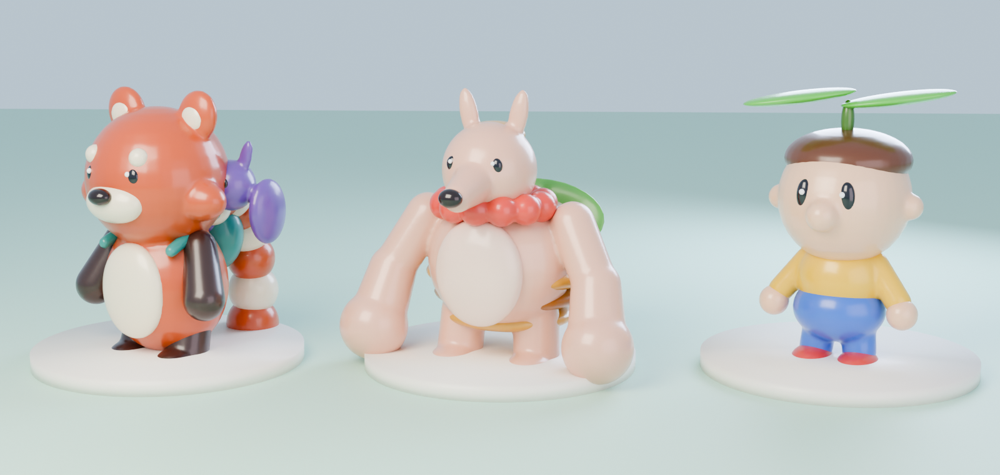

# Bolo e a corujinha: plataforma 3D (MVP)

> **Versão atual (v2):** Bolo redesenhado como panda-vermelho barrigudinho, com pelo e materiais nobres. A corujinha substitui o morcego. Os arquivos estão em `blender/hero/`:
> - `hero_b.py`: render do modelo;
> - `game_b.py`, `anims_b.py`, `owl_game.py`, `build_b.py`: versão de jogo.
>
> Na Godot, o pelo é feito em camadas (shell fur, `godot/shaders/fur.gdshader`): 18 camadas no PC e 7 na web. Folha do modelo: `docs/v2/b_sheet.png`. Poses: `docs/v2/bolo_b_poses.png`.
>
> A corujinha pousa na cabeça do Bolo quando ele está parado ou andando. Ela levanta voo quando ele corre ou pula, dá o impulso do pulo duplo e o carrega no planar.
>
> O texto abaixo descreve a v1 (vinil); a mecânica e os controles continuam os mesmos.

# v1: Bolo & Pip

Personagem de plataforma 3D em terceira pessoa, com co-op previsto, nas linhas de Banjo-Kazooie, Donkey Kong 64 e Mario. **Bolo**, o panda-vermelho, é o jogável; **Pip**, o morceguinho, voa em volta dele como a Navi e entra nas mecânicas.

O pedido consolidado está em [`PROMPT.md`](PROMPT.md).



## Como jogar

| Ação | PC (teclado/controle) | Celular |
|---|---|---|
| Mover | WASD / analógico esquerdo (Shift = andar) | arraste no lado esquerdo |
| Pular | Espaço / A (segurar = pulo mais alto) | botão PULO |
| Pulo duplo | pular de novo no ar (Bolo pisa no Pip) | PULO de novo no ar |
| Planar | segurar o pulo caindo (o Pip carrega o Bolo) | segurar PULO caindo |
| Agarrar borda | pular em direção a uma parede alta; frente/pulo sobe, trás solta | idem com o joystick |
| Câmera | mouse (clique para capturar) / analógico direito | arraste no lado direito |

Também entram, sem botão próprio: derrapagem (inverter a direção correndo), pouso pesado (cair de mais de 4 m) e a brincadeira com o Pip (fique parado ~6 s).

Na versão web: `#at=x,y,z` começa o Bolo em outro ponto e `#debug` registra as mudanças de estado no console. Um exemplo é `#debug;at=13,10.2,-22`, que nasce no alto da torre.

## Estrutura

```
platformer3d/
  blender/                 tudo em bpy (Blender 5.2 como módulo Python), reprodutível
    vinyl.py               materiais de vinil, peças fundidas (voxel remesh + suavização), skinning por distância
    anim.py                autoria pose a pose em eixos do mundo, easing por segmento, overlays e bake
    bolo.py, bolo_anims.py modelo, rig e as 14 animações do Bolo
    pip.py, pip_anims.py   modelo, rig e as 5 animações do Pip
    build.py               gera godot/assets/bolo.glb e pip.glb (--sheet renderiza as folhas de revisão)
    concepts.py            as três propostas iniciais
  godot/                   projeto Godot 4.7 (Forward+ no PC, Compatibility na web)
    scripts/bolo.gd        controlador e máquina de estados
    scripts/cam.gd         câmera orbital (estilo Odyssey)
    scripts/pip.gd         companheiro com mola e os modos boost/carry/tease
    scripts/main.gd        cenário de teste
    scripts/touch_ui.gd    joystick e botões de toque
  tools/web/               empacotamento da versão web (wasm em gzip)
  docs/                    renders das propostas e folhas de poses
```

```sh
cd platformer3d/blender
/opt/bpyenv/bin/python build.py --sheet   # precisa do pacote pip "bpy" (Blender 5.2) e de Pillow
```

## Animação: princípios da Disney aplicados

Cada clipe em `bolo_anims.py` diz no docstring quais princípios usa. Em resumo:

- **Squash & stretch:** no osso `squash`, ancorado nos pés, mantendo o volume. Agacha na antecipação e na recuperação, estica ao decolar e cair, achata nos pousos.
- **Antecipação:** o agachamento de 2 frames do pulo casa com os 3 frames de "jump squat" do controle, para o visual não atrasar o comando.
- **Follow-through e overlapping action:** a cauda (5 ossos), as orelhas e a cabeça entram com atraso de fase em relação ao corpo.
- **Slow in/slow out:** easing por segmento entre poses-chave (`inout`, `out` para impactos, `in` para arrancadas).
- **Arcos:**
  - a cambalhota do pulo duplo gira em volta do centro do corpo, não do quadril;
  - o planar balança como um pêndulo sob a pegada do Pip.
- **Ação secundária:**
  - o Pip, como trampolim do pulo duplo, carregador no planar e provocador no idle;
  - a inclinação nas curvas, calculada no jogo.
- **Exagero e appeal:** cabeça grande (o próprio Steve Mayles aumentou a do Banjo), olhos que crescem na surpresa e piscada por squash vertical.

## Controle (game feel)

- Coyote time de 0,12 s e buffer de pulo de 0,12 s.
- Altura variável: soltar cedo corta a subida.
- Gravidade maior na queda que na subida.
- Pulo duplo uma vez por voo.
- Planar segurando o pulo enquanto cai.
- Derrapagem com memória curta de velocidade, para funcionar até no teclado.
- Pouso pesado acima de 4 m.
- Agarrar borda por raycasts. O ponto de pegada vem de medidas tiradas do rig no Blender: as mãos ficam em cima da borda e a frente da cabeça encosta na parede, porque os braços do Bolo são curtos perto da cabeça.
- Câmera que só se recentraliza quando o Bolo se afasta dela, para não girar sozinha quando ele vem na direção da câmera.

## Cenário de teste

Estações rotuladas no mundo:
- corrida e derrapagem;
- degraus;
- pulo duplo (muro de 3,6 m; o pulo simples chega a 2,4 m);
- planar (vão entre plataformas de 4 m e 3 m);
- borda (muro de 2,9 m);
- torre de 10 m para o pouso pesado;
- rampas.
