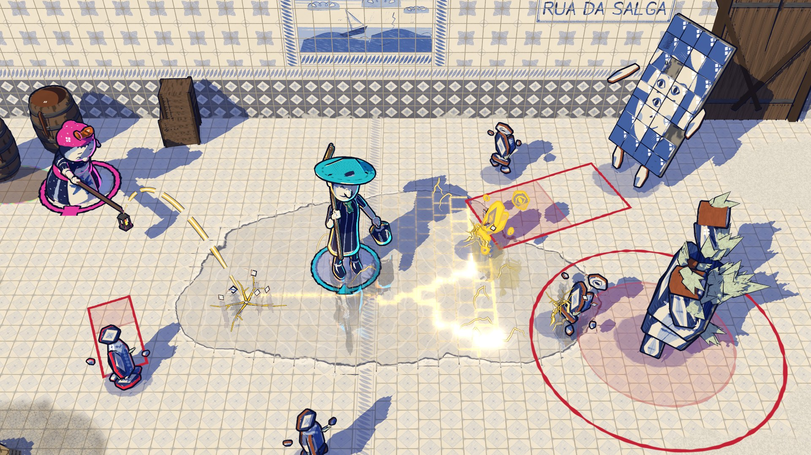
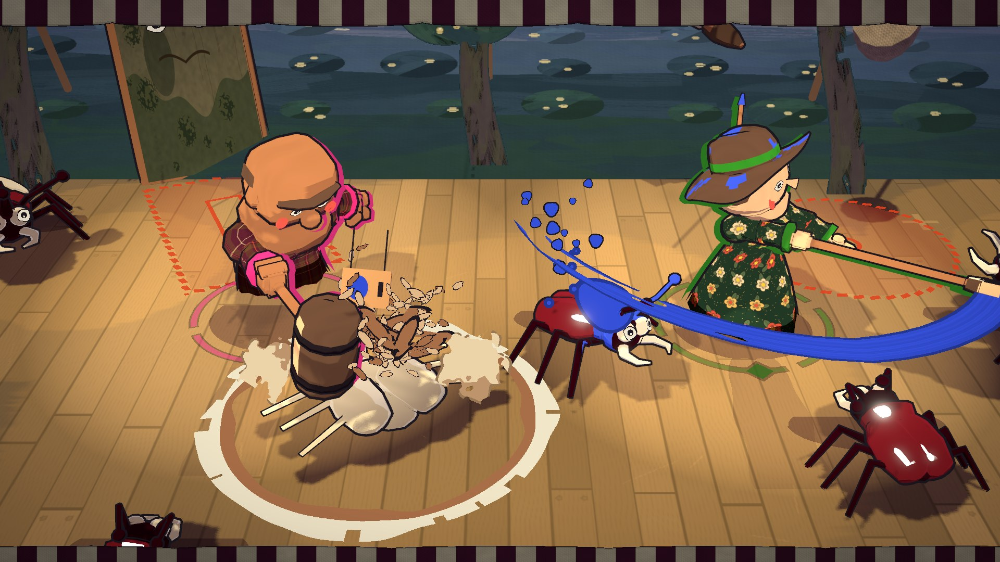
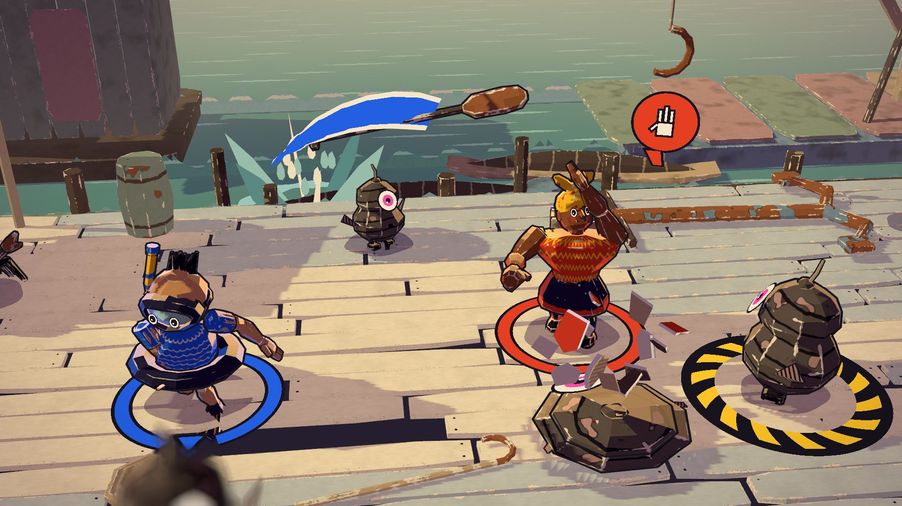

# RPG de ação co-op: pré-produção

Ainda não há jogo aqui. Esta pasta reúne a pesquisa, os conceitos e as provas de estilo usados para escolher a ideia antes de construir.

| Pasta | O que tem |
|---|---|
| `docs/pesquisa/` | 8 relatórios (jogos de referência, direção de arte, render e VFX no Godot, addons, pipeline do Blender, animação pelos 12 princípios, co-op e rede, ferramentas) e 5 complementos (prova do boneco, diferenciação de Cordels & Spells, celular, geração de fases, pilha Godot 4.7.2) |
| `docs/conceitos/` | 4 conceitos completos, as notas dos juízes e `proposta.md`, com os 3 finalistas, a revisão do red team e as decisões em aberto |
| `provas/<finalista>/` | prova de estilo de cada finalista: `midia/` (quadro no nível PC, estresse com 4 heróis e 20 inimigos, clipe e folha de modelo), `notas.md` e `codigo/` (scripts bpy, shaders e cena Godot) |

Finalistas: **Cacos de Cobalto** (magia no chão de azulejo, o mais perto de Magicka), **Tolda Viva** (bonecos de luva num palco operado em grupo) e **Tralha da Cheia** (arsenal de rio com passe de arma, o mais perto de Lost Castle 2).

| | |
|---|---|
|  |  |
|  | |

As provas foram renderizadas no Godot 4.7.2 com modelos e animações gerados em Python no Blender 5.3, sem assets baixados.
