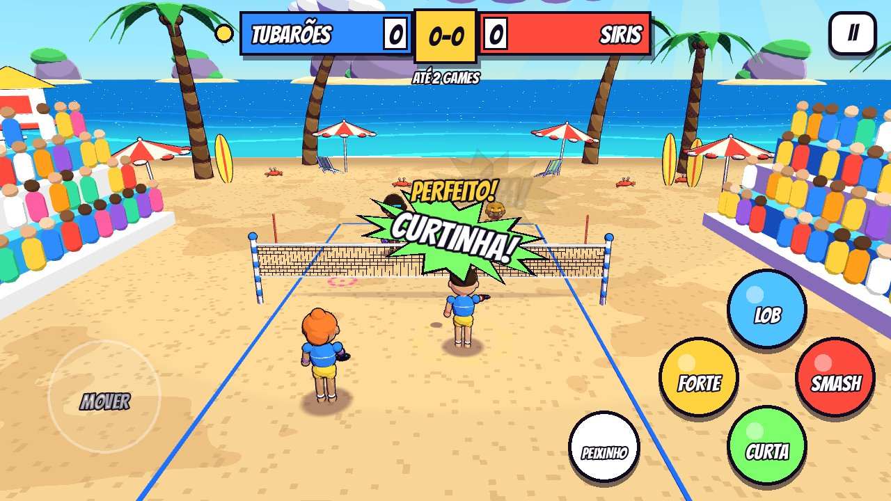
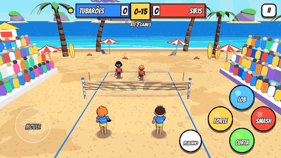
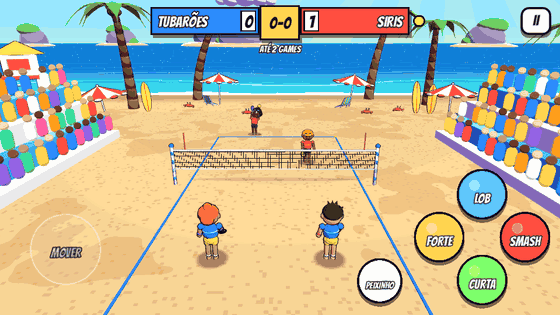
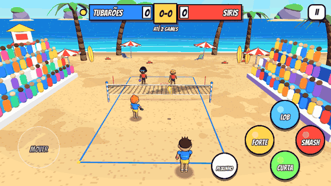
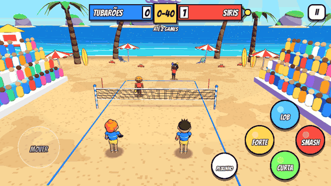

# Smash na Areia 🏖️🎾

Beach tennis arcade em 3D com visual de gibi, feito com **Godot 4.5** e modelos
gerados no **Blender**. Partidas de duplas no estilo arcade (2x2, você + parceiro
controlado pela IA contra uma dupla da IA), com golpes variados, mergulhos,
smash com pulo e onomatopeias de quadrinho.

**APK da demo:** [`builds/SmashNaAreia-demo.apk`](builds/SmashNaAreia-demo.apk)
(Android 7+, arm64 e armv7). Baixe no celular, permita "instalar apps
desconhecidos" e abra. O jogo roda deitado (paisagem).

| Menu | Smash com pulo | Curtinha |
|---|---|---|
|  |  |  |

### Gameplay

| Lob, smash, peixinho e defesa | Saque viagem |
|---|---|
|  |  |
| **Curtinha e smash** | **Nossa dupla cravando** |
|  |  |

Os GIFs saem do próprio jogo: `godot --path godot --fixed-fps 30 -- --autoplay --shots=/tmp/rec --shotdt=0 --shotmax=2400`
grava um frame por quadro (e imprime no terminal os eventos `EVT` com o número do frame de cada golpe),
depois o `ffmpeg` recorta os trechos.

## Como jogar

As regras são de beach tennis:

- **A bola não pode quicar.** Se ela cair na areia do seu lado, o ponto é do adversário.
- **Um toque por dupla.** Você ou o parceiro rebate, e a bola tem que passar a rede.
- Bola que cai **fora** é ponto de quem não bateu por último. Bola na rede é ponto do outro lado.
- **Saque único**, sem segunda chance.
- Contagem de tênis (0, 15, 30, 40) com **ponto de ouro** no 40-40. A partida vai até 2 games (rápida) ou 4 games (normal).

### Controles (toque)

| Controle | O que faz |
|---|---|
| Analógico (metade esquerda da tela) | Corre pela areia. Na hora da batida, a direção do analógico **mira** o golpe (lado e profundidade). Sem direção, o boneco mira no buraco entre os adversários. |
| **FORTE** | Golpe chapado, rápido e baixo. |
| **LOB** | Bola alta que cai no fundo, boa para tirar a dupla da rede. |
| **CURTA** | Deixadinha que morre perto da rede. |
| **SMASH** | Com a bola alta, o boneco **pula e crava** no tempo certo. Com a bola baixa vira uma pancada. Perto da rede é quase indefensável, do fundo sai mais lento. |
| **PEIXINHO** | Mergulho para salvar bola longe. Rebate sozinho uma defesa alta. |

- Aperte o golpe **um pouco antes** da bola chegar: o boneco prepara o movimento e
  bate no ponto ideal. O **anel amarelo** no chão acende quando a bola está ao seu alcance.
- O **alvo tracejado** na areia mostra onde a bola vai cair. Amarelo é bola sua, azul é do parceiro
  (ele grita "MINHA!"), rosa é do lado adversário e branco quer dizer que vai sair.
- Pancada forte chegando? Um FORTE ou CURTA vira **DEFESA** automática. O LOB devolve alto.
- **Saque:** com a bola na mão, escolha o golpe. FORTE é saque chapado, LOB é saque alto,
  CURTA é saque curto e SMASH é o **saque viagem** (pulando), mais forte e mais arriscado.

No PC: WASD/setas movem, `J` forte, `K` lob, `L` curta, `I` smash, `Espaço` pula,
`Shift` peixinho e `Esc` pausa.

### Personagens

| | Estilo | Velocidade | Força | Controle |
|---|---|---|---|---|
| **Tuca** | Equilibrado | ●●● | ●●● | ●●● |
| **Bia** | Velocista | ●●●● | ●● | ●●● |
| **Zeca** | Pancadão | ●● | ●●●● | ●● |
| **Lola** | Precisa | ●●● | ●● | ●●●● |

A IA tem 3 níveis (fácil, médio e difícil). O nível muda o tempo de reação, a velocidade,
a precisão, a frequência de smash, o mergulho e a leitura de bola que vai sair ("FORA!", "DEIXA!").

## Estrutura

```
smash-areia/
├── blender/build_assets.py   # modela tudo no Blender (bpy): personagem, raquete, palmeira,
│                             #   guarda-sol, cadeira, posto de salva-vidas, nuvem, postes,
│                             #   arquibancada, prancha, ilha e siri  ->  godot/assets/models/*.glb
├── tools/gen_audio.py        # sintetiza todos os sons e a música (WAV)
├── tools/build_apk.sh        # gera assets e exporta o APK
├── builds/SmashNaAreia-demo.apk
└── godot/
    ├── project.godot / export_presets.cfg
    ├── shaders/              # toon (cel-shading + retícula de gibi), contorno, areia, mar, céu, rede, torcida
    └── scripts/
        ├── main.gd           # regras, saque, placar com ponto de ouro, câmera, efeitos, modo demo do menu
        ├── player.gd         # movimento na areia, pulo, mergulho, golpes e animação procedural
        ├── ai_brain.gd       # IA: previsão de interceptação, posicionamento, escolha de golpe e mira
        ├── shots.gd          # balística exata de cada golpe (passa a rede com folga, erro por qualidade)
        ├── ball.gd           # física da bola (parábola exata), rede, rastro
        ├── world.gd          # praia, quadra, rede, cenário e torcida (MultiMesh)
        ├── hud.gd            # menu com prévia 3D do personagem, placar, pausa, fim de jogo
        ├── touch_controls.gd # analógico flutuante e botões multi-touch
        ├── comic_fx.gd       # "POW!", "LOB!", "DEFESA!", linhas de velocidade
        └── toon.gd, game_data.gd
```

### Visual de gibi

- **Cel-shading** em 3 faixas, com **retícula de pontinhos** (halftone) nas sombras
  e brilho de borda, tudo `unshaded` para ficar igual em qualquer celular.
- **Contorno preto** em todos os modelos (inverted hull).
- Personagens de "borracha" modelados no Blender: cabeça grande, nariz de bolinha,
  olhos de botão. Cada parte do corpo é um objeto com pivô na articulação, e o Godot
  anima tudo por código (corrida, preparação e batida de cada golpe, pulo com
  squash & stretch, mergulho, comemoração).
- Onomatopeias em estrelas de quadrinho, linhas de velocidade e tremida de câmera no smash,
  com uma pausa curtinha no impacto (hit-stop).

## Gerando de novo

Pré-requisitos: Godot 4.5.1 com os export templates, Android SDK (build-tools com
`apksigner`) configurado nas Editor Settings, Python 3 com `numpy` e, para os modelos,
o Blender (ou o módulo `bpy` do pip).

```sh
# modelos 3D (opcional, os .glb já estão no repositório)
blender -b -P blender/build_assets.py        # ou: python blender/build_assets.py (com pip install bpy)

# sons + importação + APK
GODOT=/caminho/godot BLENDER_PY=python3 tools/build_apk.sh
```

Para rodar no PC, abra `godot/project.godot` no editor e aperte F5.

### Testes automáticos

O jogo aceita argumentos depois de `--` para testes sem tela:

```sh
godot --headless --path godot --fixed-fps 60 -- --sim         # 300 pontos IA x IA, imprime estatísticas
godot --headless --path godot --fixed-fps 60 -- --keytest     # aperta teclas como um jogador
godot --path godot -- --autoplay --shots=/tmp/fotos           # joga sozinho e tira screenshots
```

## Créditos

- Fonte **Bangers** (SIL Open Font License, ver `godot/assets/fonts/OFL.txt`).
- Modelos, sons e música feitos por código neste repositório.
- O APK da demo é assinado com uma chave de debug. Para publicar na loja, gere com a sua keystore
  (`GODOT_ANDROID_KEYSTORE_RELEASE_PATH/USER/PASSWORD`).
