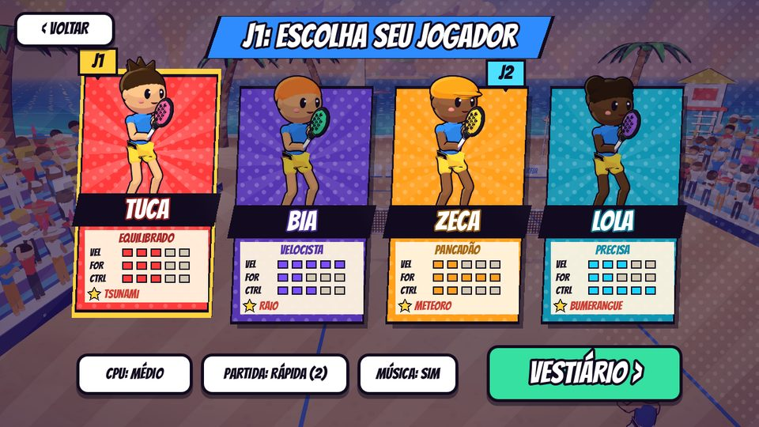
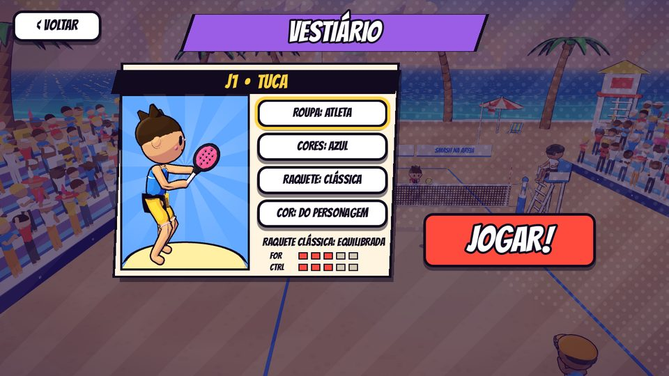
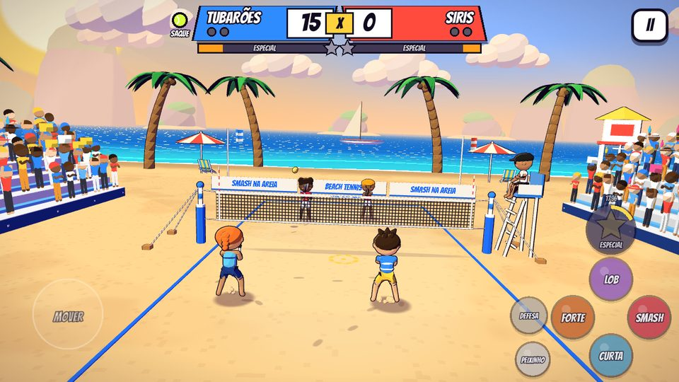
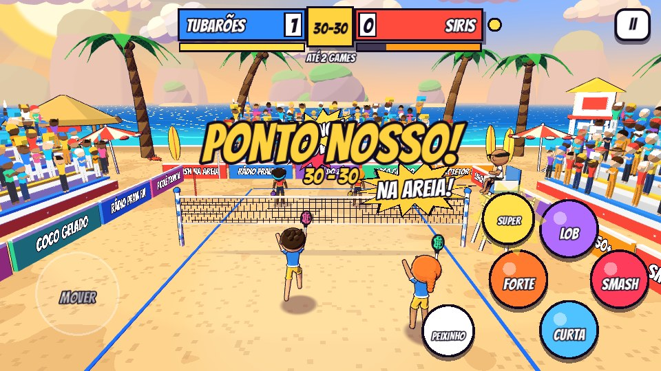

# Smash na Areia 🏖️🎾

Beach tennis arcade em 3D com visual de gibi, feito com **Godot 4.5** e modelos
gerados no **Blender**. Partidas de duplas no estilo arcade (2x2, você + parceiro
controlado pela IA contra uma dupla da IA), com golpes variados, mergulhos,
smash com pulo e onomatopeias de quadrinho.

**APK da demo:** [`builds/SmashNaAreia-demo.apk`](builds/SmashNaAreia-demo.apk)
(Android 7+, arm64 e armv7). Baixe no celular, permita "instalar apps
desconhecidos" e abra. O jogo roda deitado (paisagem).

| Personagens | Vestiário | 1 jogador | VS em tela dividida |
|---|---|---|---|
|  |  |  |  |

## Menus

1. **Título** com logo de gibi, raios girando e os quatro personagens. Qualquer toque ou botão entra.
2. **Modo**: três painéis (1 JOGADOR, VERSUS, CO-OP) que mostram quem joga contra quem.
3. **Personagens**: cards com retrato, atributos em barrinhas e o nome do especial. No 2P o J1
   escolhe primeiro e depois o J2 (marcadores J1/J2 em cima dos cards). Na mesma tela: nível da CPU,
   tamanho da partida e música.
4. **Vestiário**: prévia 3D girando de cada jogador e a escolha de
   - **roupa**: camiseta, regata, listrada (com bermuda) ou atleta;
   - **cores**: 3 paletas por time, sempre no tom da dupla para não confundir em quadra;
   - **raquete**: CLÁSSICA (equilibrada), GOTA (+ controle) ou POWER (+ força). Cada modelo tem
     formato próprio (redonda, cabeça longa ou cabeça larga com aro duplo) e muda força e controle;
   - **cor da raquete**: a do personagem ou uma de 8 cores.

   Os parceiros e adversários da CPU sorteiam roupa, cores e raquete a cada partida.
   As roupas são uma "casca" copiada do próprio corpo no Blender (cortes retos com bisect) e herdam
   os mesmos pesos dos ossos, então a pele nunca atravessa o tecido em nenhuma pose.

Tudo funciona no toque, no mouse, no teclado e no controle (D-pad + A, B volta).

### Vídeo: 1 minuto de partida (com som)

[](docs/partida-1min.mp4)

[`docs/partida-1min.mp4`](docs/partida-1min.mp4) mostra o **modo VS em tela dividida**. Foi gravado
direto do jogo com o Movie Maker do Godot (vídeo e som do próprio jogo), com o computador jogando pelas duas duplas:

```sh
godot --path godot --resolution 1280x720 --write-movie partida.avi --fixed-fps 30 --quit-after 1830 -- --autoplay --mode=vs
ffmpeg -i partida.avi -vf scale=1024:-2 -c:v libx264 -crf 30 -c:a aac docs/partida-1min.mp4
```

## Modos e multiplayer local

| Modo | Como funciona |
|---|---|
| **1 JOGADOR** | Você + parceiro da IA contra uma dupla da IA. Toque, teclado ou controle. |
| **VS (2P)** | J1 contra J2, cada um com um parceiro da IA, em **tela dividida**: cada jogador tem a sua câmera atrás da própria dupla. |
| **CO-OP (2P)** | J1 e J2 na mesma dupla contra a IA, numa tela só. |

- **Botões de toque somem sozinhos** quando o J1 joga no controle e voltam ao tocar na tela.
- **Controles (gamepad)**: com 2 controles conectados, cada jogador usa um. Com 1 controle, o J2 fica
  com ele e o J1 joga no teclado (ou toque no modo co-op). No celular, o VS precisa de dois
  controles Bluetooth, porque os botões de toque somem na tela dividida.
- Mapeamento do controle: **A** forte, **X** lob, **B** curta, **Y** smash, **LB** (ou RT/R3) defesa,
  **RB** especial, **LT** (ou L3) peixinho, **Start** pausa, analógico ou D-pad para correr e mirar.
  Os gatilhos também são lidos como botão (alguns controles no Android não mandam eixo), e o
  mapa aparece na tela no começo da partida e em PAUSA > CONTROLES.
- Apertar o ESPECIAL com a barra incompleta mostra a % acima do jogador (o botão respondeu, só falta
  carregar). Com a barra cheia ele fica **armado** até a próxima bola sua, sem desperdiçar.
- O J2 também pode jogar no teclado: setas, `N` forte, `M` lob, `,` curta, `.` smash, `/` defesa,
  `B` especial e `V` peixinho.
- Os menus funcionam no controle (D-pad + A). Cada jogador humano tem um marcador "J1"/"J2" em cima.
- O controle **vibra** nas batidas (mais forte no smash, no super e quando você é empurrado), e dá
  para conectar ou desconectar controles no meio da partida: os jogadores são redistribuídos na hora.

## Como jogar

As regras são de beach tennis:

- **A bola não pode quicar.** Se ela cair na areia do seu lado, o ponto é do adversário.
- **Um toque por dupla.** Você ou o parceiro rebate, e a bola tem que passar a rede.
- Bola que cai **fora** é ponto de quem não bateu por último. Bola na rede é ponto do outro lado.
- **Saque único**, sem segunda chance.
- Contagem oficial do beach tennis (ITF): **0, 15, 30, 40** e game, com **ponto de ouro** no 40-40
  (sem vantagem).
- Tamanho da partida: **RÁPIDA** (quem fizer 2 games), **NORMAL** (4 games) ou **SET OFICIAL**:
  6 games com 2 de vantagem e, no 6-6, **tie-break** até 7 pontos (2 de vantagem). No tie-break o
  placar conta 1, 2, 3... e o saque troca depois do 1º ponto e depois a cada 2.
- **Saque em rodízio**: as duplas alternam o saque a cada game, e dentro da dupla os dois jogadores
  se revezam (no seu time, você e o parceiro sacam em games alternados).
- **Placar**: cada dupla mostra os próprios pontos em destaque (pisca quando pontua), os games
  ganhos em bolinhas, a bolinha de SAQUE e a barra do especial. A cada ponto aparece o motivo
  ("CAIU NA AREIA DOS SIRIS", "MANDARAM FORA", "NA REDE").

### Controles (toque)

| Controle | O que faz |
|---|---|
| Analógico (metade esquerda da tela) | Corre pela areia. Na hora da batida, a direção do analógico **mira** o golpe (lado e profundidade). Sem direção, o boneco mira no buraco entre os adversários. |
| **FORTE** | **Topspin**: rápido, mergulha no fim e fica difícil de devolver. |
| **LOB** | Bola alta com topspin que cai no fundo, boa para tirar a dupla da rede. |
| **CURTA** | **Slice**: flutua, faz curva e morre perto da rede. |
| **SMASH** | Com a bola alta, o boneco **pula e crava** no tempo certo. Com a bola baixa vira uma pancada. Perto da rede é quase indefensável, do fundo sai mais lento. |
| **DEFESA** | Devolve uma bola alta, funda e segura no meio da quadra. Alcança mais longe e aguenta pancada (bloqueio). Enquanto está armada aparece um **escudo azul** na frente do jogador e "DEFESA!" em cima; o escudo pisca quando pega a bola. |
| **PEIXINHO** | Mergulho para salvar bola longe. Rebate sozinho uma defesa alta. |
| **ESPECIAL** (estrela grande acima do losango) | Enche junto com a barra ESPECIAL do placar (mostra a %) e pulsa com "PRONTO!" quando está cheia: solta o golpe especial do seu personagem. Também aparece um aviso na tela dizendo qual botão apertar (RB, U ou a estrela). |

### Efeito, golpe carregado, chance e super (inspirado nos tênis arcade)

- **A bola tem efeito de verdade.** Topspin derruba a bola, slice faz ela flutuar e o efeito
  lateral faz curva. Tudo é física (força de Magnus e resistência do ar), e a bola gira na tela.
  A mira é calculada por simulação, então a bola curva mas cai onde você mirou.
- **Golpe carregado:** aperte o golpe **cedo**. Enquanto a bola não chega, o boneco carrega o
  golpe (aura colorida no chão e tremidinha). Quanto mais carga, mais força e mais efeito.
- **Estrela de chance:** quando o adversário devolve uma bola fraca, aparece uma estrela colorida
  na areia. Pare em cima e bata com o golpe da **mesma cor** (laranja = forte, vermelho = smash,
  azul = curta). Sai um golpe "CHANCE!" mais forte e que enche mais a barra.
- **Barra de energia e super golpe:** golpes perfeitos, carregados, de chance, smashes e pontos
  enchem a barra (embaixo do placar). Cheia, o botão SUPER brilha:
  - **Tuca: TSUNAMI**: topspin monstruoso com rastro de água, que despenca no fundo da quadra.
  - **Bia: RAIO**: bola chapada em zigue-zague, muito rápida.
  - **Zeca: METEORO**: pulo altíssimo e uma cravada em chamas.
  - **Lola: BUMERANGUE**: sai por fora da quadra e volta fazendo uma curva enorme.

  Quem recebe um super é **empurrado para trás** e só consegue uma defesa fraca. Às vezes é o ponto
  de chance para fechar!

### Movimentos e golpes automáticos

Você escolhe o **tipo** do golpe (forte, lob, curta, smash) e o boneco escolhe o **movimento**
pela posição da bola:

- **Forehand** quando a bola vem do lado da raquete e **backhand** quando vem do outro lado,
  com o corpo virando de lado antes da batida.
- **Bola baixa**: agacha com os joelhos dobrados. **Bola longe**: avanço lateral largo.
- **Gancho**: bola alta que passa por cima ou por trás da cabeça. O boneco vira de lado, dá um
  pulinho e passa a raquete num arco por cima da cabeça. Dá para devolver lobs que
  pareciam perdidos.
- **Bloqueio**: contra pancada, defesa curta com base larga e raquete na frente do peito.
- **Peixinho** para as bolas impossíveis.
- Entre os golpes: **split-step** (pulinho de preparação quando o adversário bate),
  **passo lateral** de frente para a rede, **recuo de costas** para o lob e corrida.

### Poses de beach tennis

- **Posição de espera**: base larga, joelhos flexionados, tronco para a frente e raquete em pé na
  frente do corpo, de perfil para a rede, com a **mão livre apoiando a garganta da raquete**
  (cinemática inversa de dois ossos no braço esquerdo).
- **Backhand** preparado com as duas mãos na raquete (giro de ombro), soltando a mão livre na batida.
- **Forehand de voleio** com preparação curta, braço livre apontando a bola e passo com o pé esquerdo.
- **Smash e saque** na "pose do troféu": braço livre apontando a bola, cotovelo alto, raquete
  caída atrás das costas, corpo de lado e **chute de tesoura** no pulo.

### Detalhes de jogo

- **Raquete sempre na posição certa**: a raquete é orientada por código a cada quadro. Na espera
  fica de pé na frente do corpo, e na batida a face vira para a direção do golpe.
- **Recepção do saque**: quem recebe fica na diagonal de quem saca, no meio-fundo, e o parceiro
  fica perto da rede. A IA se posiciona para pegar a bola ao lado do corpo, no forehand ou no
  backhand, o que estiver mais perto.
- **Smash no tempo certo**: com a bola muito alta, o boneco espera ela descer antes de pular. Do
  fundo da quadra ele não pula (vira smash de chão ou gancho).
- **Bola de borracha**: amassa no impacto com a raquete e na areia e estica conforme a velocidade.
  Os rastros são neutros, e só os super golpes têm cor.

### Outras dicas

- Aperte o golpe **um pouco antes** da bola chegar: o boneco prepara o movimento e
  bate no ponto ideal. O **anel amarelo** no chão acende quando a bola está ao seu alcance.
- O **alvo tracejado** na areia mostra onde a bola vai cair. Amarelo é bola sua, azul é do parceiro
  (ele grita "MINHA!"), rosa é do lado adversário e branco quer dizer que vai sair.
- Pancada forte chegando? Um FORTE ou CURTA vira **DEFESA** automática. O LOB devolve alto.
- **Saque:** com a bola na mão, escolha o golpe. FORTE é saque chapado, LOB é saque alto,
  CURTA é saque curto e SMASH é o **saque viagem** (pulando), mais forte e mais arriscado.

No PC (J1): WASD move, `J` forte, `K` lob, `L` curta, `I` smash, `O` defesa, `U` super,
`Espaço` pula, `Shift` peixinho e `Esc` pausa.

### Personagens

| | Estilo | Velocidade | Força | Controle | Super |
|---|---|---|---|---|---|
| **Tuca** | Equilibrado | ●●● | ●●● | ●●● | Tsunami |
| **Bia** | Velocista | ●●●● | ●● | ●●● | Raio |
| **Zeca** | Pancadão | ●● | ●●●● | ●● | Meteoro |
| **Lola** | Precisa | ●●● | ●● | ●●●● | Bumerangue |

A IA tem 3 níveis (fácil, médio e difícil). O nível muda o tempo de reação, a velocidade,
a precisão, a frequência de smash, o mergulho e a leitura de bola que vai sair ("FORA!", "DEIXA!").

## Som

Design de som feito do zero em `tools/gen_audio.py` (numpy + scipy), com camadas de impactos
gravados da Kenney (CC0, em `tools/kenney/`), e um mixer dinâmico em `scripts/audio.gd`:

- **Raquete**: síntese modal do quadro de carbono/EVA, clique do impacto e "pop" da bola de
  borracha, mais uma camada gravada. Há variações para cada golpe (forte, lob, curta, bloqueio),
  smash com estalo, sub-grave e reverb de praia, e o super com subida e pancada gigante.
- **Raquete no ar**: whoosh com filtro varrendo a frequência na batida (mais grave no smash e no gancho).
- **Areia**: síntese granular (milhares de grãos) para os passos, a bola caindo, o mergulho e o pulo.
- **Rede**: chicote da malha, ressonância da corda e bola amortecida.
- **Apito de juiz** com "ervilha" (trinado irregular perto de 3 kHz).
- **Torcida**: murmúrio de dezenas de vozes por formantes, aplauso feito de centenas de palmas
  individuais, assobios, "uhhh!" nos lances perigosos e "aaah..." na decepção.
- **Música adaptativa** (samba-pop de praia, 122 bpm, 1 minuto em loop): cavaquinho/uke no
  contratempo em Karplus-Strong, baixo "slap", batucada (surdo, tamborim, agogô, congas, palmas,
  apito de samba) e um refrão grudento de **steel drum** com eco, com ponte de arpejos e metais.
  Três camadas sincronizadas: a base toca sempre, a batucada e um pouco do refrão entram no rali e o
  refrão completo nos ralis longos, com o especial pronto e no menu. Na pausa e no replay a música fica abafada.
- **Mixagem**: buses de Música, Efeitos (reverb), Torcida e Interface, com compressor e limitador no
  master. Golpes, areia e rede soam em 3D, de onde acontecem, e a torcida cresce com a emoção do rali.

Amostra: [`docs/audio-amostra.m4a`](docs/audio-amostra.m4a) (14 s do jogo, gravado com o Movie Maker do Godot).

## Estrutura

```
smash-areia/
├── blender/
│   ├── build_assets.py       # ponto de entrada + cenário (palmeira, guarda-sol, cadeira, posto, nuvem...)
│   ├── characters.py         # jogador com esqueleto (corpo único via modificador Skin), raquete, torcedores
│   └── props.py              # morros, veleiro, quiosque, cadeira do juiz, arquibancada
├── tools/gen_audio.py        # design de som: efeitos, torcida e música adaptativa (WAV/OGG)
├── tools/kenney/             # impactos gravados da Kenney (CC0) usados como camadas
├── tools/build_apk.sh        # gera assets e exporta o APK
├── builds/SmashNaAreia-demo.apk
└── godot/
    ├── project.godot / export_presets.cfg
    ├── shaders/              # toon (cel-shading, retícula, contraluz dourada, névoa, vento), contorno,
    │                         #   areia, mar, céu de fim de tarde, rede, torcida, bandeira, faíscas,
    │                         #   impacto, estrela de chance, rastros
    └── scripts/
        ├── main.gd           # regras, saque, placar, energia/super, chance, efeitos, câmera, modo demo
        ├── player.gd         # movimento, pulo, mergulho, golpe carregado, empurrão e animação procedural
        ├── rig.gd            # poses do esqueleto nos eixos do personagem (joelho, cotovelo, tronco)
        ├── ai_brain.gd       # IA: previsão da trajetória, posicionamento, escolha de golpe, chance e super
        ├── shots.gd          # física dos golpes: Magnus, arrasto, mira por simulação, super golpes
        ├── ball.gd           # bola com efeito, trajetória pré-simulada (previsão exata), rastros
        ├── world.gd          # praia, quadra, juiz, arquibancadas com torcida, placas, bandeiras, horizonte
        ├── hud.gd            # menu com prévia 3D, placar com barras de energia, pausa, fim de jogo
        ├── touch_controls.gd # analógico flutuante e botões multi-touch (com a estrela ESPECIAL)
        ├── comic_fx.gd       # letreiros pequenos, linhas de velocidade, flash
        └── toon.gd, game_data.gd
```

### Visual

- **Personagens limpos e articulados**: o corpo é uma malha única gerada no Blender pelo
  modificador Skin sobre um esqueleto de 16 ossos, com pesos de skinning calculados por
  distância. Camiseta e short são peças separadas (bordas redondas, sem emendas) e o rosto
  é só o essencial: olhos com brilho, sorriso e bochechas, com o cabelo em formas fechadas. Joelhos e cotovelos dobram, os pés ficam no chão (o quadril desce conforme as
  pernas dobram), o tronco gira nos golpes e a raquete deixa um rastro ("smear").
- **Cel-shading** com retícula de gibi nas sombras, **contraluz dourada** do sol de fim de tarde,
  **névoa de distância** e **contorno preto** em tudo.
- **Câmera de TV** viva: avança quando a bola vem e recua quando ela vai, aperta conforme o rali
  esquenta, inclina de leve com a jogada, balança um pouco (câmera na mão), dá um empurrão no smash e
  inclina forte (ângulo holandês) no super. O movimento é suave (mola amortecida) e antecipa para onde a bola vai:
  baixa e atrás do fundo da quadra no rali (estilo tênis arcade, com o lado adversário
  "comprimido"), close da comemoração pela lateral, por cima do ombro no saque, entrada cinematográfica, zoom no smash e no
  super e close na comemoração. Pontos decididos por super, gancho, smash depois de rali ou rali
  longo ganham **replay em câmera lenta** pela lateral (toque para pular).
- **Rede caprichada**: malha com fios suavizados e caimento no meio, que treme quando a bola
  bate. Tem faixas com texto, antenas listradas, cabos até os postes, estais presos em estacas
  na areia e protetor acolchoado nos postes.
- **Plateia viva**: quatro tipos de torcedor (braços para cima, plaquinha, mãozona de espuma,
  palmas) com cores sorteadas, só nas arquibancadas laterais (o fundo fica livre para ver o mar).
  Eles viram o corpo seguindo a bola e fazem a **ola** quando a sua
  dupla pontua. O juiz na cadeira acompanha a bola com a cabeça e levanta o braço no apito.
- **Céu de gibi**: degradê em faixas suaves, sol com contorno e halos em anel, raios girando e
  fiapos de cirros. **Nuvens** em três formatos com base achatada, topo branco, barriga rosada e
  borda dourada contra o sol, em camadas que ficam mais claras com a distância e andam devagar.
- **Batidas**: estrela de impacto + **onda de choque** com traços de velocidade (dupla nas pancadas).
- **Areia viva**: pegadas que somem com o tempo, marca do mergulho, onda de areia quando a bola
  cai, confete nos pontos (chuva maior no game) e vinheta suave de cinema nas bordas.
- **Controles de toque** compactos e semitransparentes (acendem ao tocar), com o losango de golpes no
  canto, a estrela ESPECIAL logo acima e DEFESA e PEIXINHO ao lado.
- Letreiros **pequenos e rápidos**, só nos lances especiais. Nas batidas comuns entram faíscas e
  uma estrela de impacto 3D da cor do golpe.

## Gerando de novo

Pré-requisitos: Godot 4.5.1 com os export templates, Android SDK (build-tools com
`apksigner`) configurado nas Editor Settings, Python 3 com `numpy` e, para os modelos,
o Blender (ou o módulo `bpy` do pip).

```sh
# modelos 3D (opcional, os .glb já estão no repositório)
blender -b -P blender/build_assets.py        # ou: python blender/build_assets.py (com pip install bpy)

# sons + importação + APK
GODOT=/caminho/godot BLENDER_PY=python3 tools/build_apk.sh
```

Para rodar no PC, abra `godot/project.godot` no editor e aperte F5.

Retratos dos cards (`godot/assets/ui/char_N.png`), renderizados pelo próprio jogo e recortados:

```sh
godot --path godot --resolution 720x720 -- --char=N --portrait=/tmp/card_N.png   # "card" no nome = enquadramento 3/4
```

### Testes automáticos

O jogo aceita argumentos depois de `--` para testes sem tela:

```sh
godot --headless --path godot --fixed-fps 60 -- --sim         # 300 pontos IA x IA, imprime estatísticas
godot --headless --path godot --fixed-fps 60 -- --keytest     # aperta teclas como um jogador
godot --headless --path godot --fixed-fps 60 -- --inputtest --mode=vs   # teclado do J1 e do J2, sem IA
godot --path godot -- --autoplay --shots=/tmp/fotos           # joga sozinho e tira screenshots
```

## Créditos

- Fonte **Bangers** (SIL Open Font License, ver `godot/assets/fonts/OFL.txt`).
- Modelos, sons e música feitos por código neste repositório.
- Camadas de impacto gravadas: Kenney (kenney.nl), "Impact Sounds", CC0 1.0 (`tools/kenney/CC0-1.0.txt`).
- O APK da demo é assinado com uma chave de debug. Para publicar na loja, gere com a sua keystore
  (`GODOT_ANDROID_KEYSTORE_RELEASE_PATH/USER/PASSWORD`).
