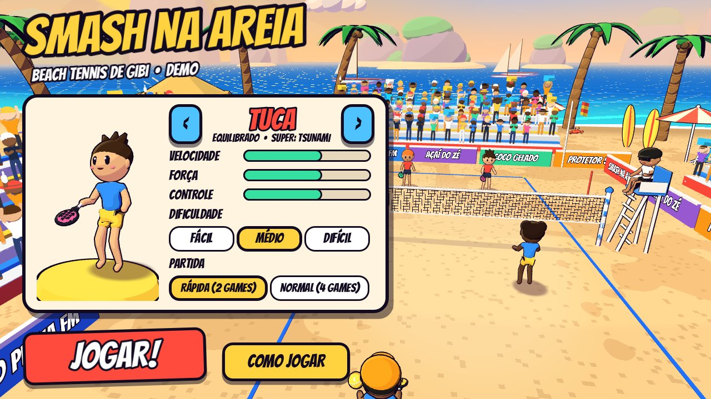
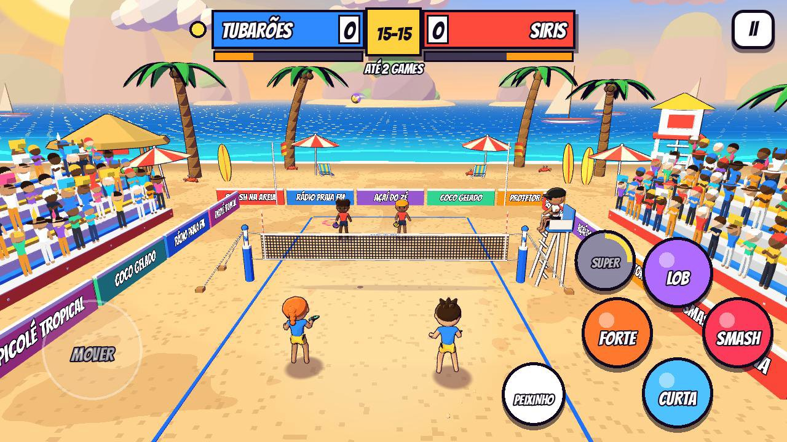

# Smash na Areia 🏖️🎾

Beach tennis arcade em 3D com visual de gibi, feito com **Godot 4.5** e modelos
gerados no **Blender**. Partidas de duplas no estilo arcade (2x2, você + parceiro
controlado pela IA contra uma dupla da IA), com golpes variados, mergulhos,
smash com pulo e onomatopeias de quadrinho.

**APK da demo:** [`builds/SmashNaAreia-demo.apk`](builds/SmashNaAreia-demo.apk)
(Android 7+, arm64 e armv7). Baixe no celular, permita "instalar apps
desconhecidos" e abra. O jogo roda deitado (paisagem).

| Menu | Rali | Rali | Replay em câmera lenta |
|---|---|---|---|
|  |  |  |  |

### Vídeo: 1 minuto de partida (com som)

[](docs/partida-1min.mp4)

[`docs/partida-1min.mp4`](docs/partida-1min.mp4) foi gravado direto do jogo com o Movie Maker do Godot
(vídeo e som do próprio jogo), com o computador jogando pelas duas duplas:

```sh
godot --path godot --resolution 1280x720 --write-movie partida.avi --fixed-fps 30 --quit-after 1830 -- --autoplay
ffmpeg -i partida.avi -vf scale=1024:-2 -c:v libx264 -crf 30 -c:a aac docs/partida-1min.mp4
```

## Como jogar

As regras são de beach tennis:

- **A bola não pode quicar.** Se ela cair na areia do seu lado, o ponto é do adversário.
- **Um toque por dupla.** Você ou o parceiro rebate, e a bola tem que passar a rede.
- Bola que cai **fora** é ponto de quem não bateu por último. Bola na rede é ponto do outro lado.
- **Saque único**, sem segunda chance.
- Contagem de tênis (0, 15, 30, 40) com **ponto de ouro** no 40-40. A partida vai até 2 games (rápida) ou 4 games (normal).

### Controles (toque)

| Controle | O que faz |
|---|---|
| Analógico (metade esquerda da tela) | Corre pela areia. Na hora da batida, a direção do analógico **mira** o golpe (lado e profundidade). Sem direção, o boneco mira no buraco entre os adversários. |
| **FORTE** | **Topspin**: rápido, mergulha no fim e fica difícil de devolver. |
| **LOB** | Bola alta com topspin que cai no fundo, boa para tirar a dupla da rede. |
| **CURTA** | **Slice**: flutua, faz curva e morre perto da rede. |
| **SMASH** | Com a bola alta, o boneco **pula e crava** no tempo certo. Com a bola baixa vira uma pancada. Perto da rede é quase indefensável, do fundo sai mais lento. |
| **PEIXINHO** | Mergulho para salvar bola longe. Rebate sozinho uma defesa alta. |
| **SUPER** | Acende quando a barra de energia enche: solta o super golpe do seu personagem. |

### Efeito, golpe carregado, chance e super (inspirado nos tênis arcade)

- **A bola tem efeito de verdade.** Topspin derruba a bola, slice faz ela flutuar e o efeito
  lateral faz curva. Tudo é física (força de Magnus e resistência do ar), e a bola gira na tela.
  A mira é calculada por simulação, então a bola curva mas cai onde você mirou.
- **Golpe carregado:** aperte o golpe **cedo**. Enquanto a bola não chega, o boneco carrega o
  golpe (aura colorida no chão e tremidinha). Quanto mais carga, mais força e mais efeito.
- **Estrela de chance:** quando o adversário devolve uma bola fraca, aparece uma estrela colorida
  na areia. Pare em cima e bata com o golpe da **mesma cor** (laranja = forte, vermelho = smash,
  azul = curta). Sai um golpe "CHANCE!" mais forte e que enche mais a barra.
- **Barra de energia e super golpe:** golpes perfeitos, carregados, de chance, smashes e pontos
  enchem a barra (embaixo do placar). Cheia, o botão SUPER brilha:
  - **Tuca: TSUNAMI**: topspin monstruoso com rastro de água, que despenca no fundo da quadra.
  - **Bia: RAIO**: bola chapada em zigue-zague, muito rápida.
  - **Zeca: METEORO**: pulo altíssimo e uma cravada em chamas.
  - **Lola: BUMERANGUE**: sai por fora da quadra e volta fazendo uma curva enorme.

  Quem recebe um super é **empurrado para trás** e só consegue uma defesa fraca. Às vezes é o ponto
  de chance para fechar!

### Movimentos e golpes automáticos

Você escolhe o **tipo** do golpe (forte, lob, curta, smash) e o boneco escolhe o **movimento**
pela posição da bola:

- **Forehand** quando a bola vem do lado da raquete e **backhand** quando vem do outro lado,
  com o corpo virando de lado antes da batida.
- **Bola baixa**: agacha com os joelhos dobrados. **Bola longe**: avanço lateral largo.
- **Gancho**: bola alta que passa por cima ou por trás da cabeça. O boneco vira de lado, dá um
  pulinho e passa a raquete num arco por cima da cabeça. Dá para devolver lobs que
  pareciam perdidos.
- **Bloqueio**: contra pancada, defesa curta com base larga e raquete na frente do peito.
- **Peixinho** para as bolas impossíveis.
- Entre os golpes: **split-step** (pulinho de preparação quando o adversário bate),
  **passo lateral** de frente para a rede, **recuo de costas** para o lob e corrida.

### Outras dicas

- Aperte o golpe **um pouco antes** da bola chegar: o boneco prepara o movimento e
  bate no ponto ideal. O **anel amarelo** no chão acende quando a bola está ao seu alcance.
- O **alvo tracejado** na areia mostra onde a bola vai cair. Amarelo é bola sua, azul é do parceiro
  (ele grita "MINHA!"), rosa é do lado adversário e branco quer dizer que vai sair.
- Pancada forte chegando? Um FORTE ou CURTA vira **DEFESA** automática. O LOB devolve alto.
- **Saque:** com a bola na mão, escolha o golpe. FORTE é saque chapado, LOB é saque alto,
  CURTA é saque curto e SMASH é o **saque viagem** (pulando), mais forte e mais arriscado.

No PC: WASD/setas movem, `J` forte, `K` lob, `L` curta, `I` smash, `U` super, `Espaço` pula,
`Shift` peixinho e `Esc` pausa.

### Personagens

| | Estilo | Velocidade | Força | Controle | Super |
|---|---|---|---|---|---|
| **Tuca** | Equilibrado | ●●● | ●●● | ●●● | Tsunami |
| **Bia** | Velocista | ●●●● | ●● | ●●● | Raio |
| **Zeca** | Pancadão | ●● | ●●●● | ●● | Meteoro |
| **Lola** | Precisa | ●●● | ●● | ●●●● | Bumerangue |

A IA tem 3 níveis (fácil, médio e difícil). O nível muda o tempo de reação, a velocidade,
a precisão, a frequência de smash, o mergulho e a leitura de bola que vai sair ("FORA!", "DEIXA!").

## Estrutura

```
smash-areia/
├── blender/
│   ├── build_assets.py       # ponto de entrada + cenário (palmeira, guarda-sol, cadeira, posto, nuvem...)
│   ├── characters.py         # jogador com esqueleto (corpo único via modificador Skin), raquete, torcedores
│   └── props.py              # morros, veleiro, quiosque, cadeira do juiz, arquibancada
├── tools/gen_audio.py        # sintetiza todos os sons e a música (WAV)
├── tools/build_apk.sh        # gera assets e exporta o APK
├── builds/SmashNaAreia-demo.apk
└── godot/
    ├── project.godot / export_presets.cfg
    ├── shaders/              # toon (cel-shading, retícula, contraluz dourada, névoa, vento), contorno,
    │                         #   areia, mar, céu de fim de tarde, rede, torcida, bandeira, faíscas,
    │                         #   impacto, estrela de chance, rastros
    └── scripts/
        ├── main.gd           # regras, saque, placar, energia/super, chance, efeitos, câmera, modo demo
        ├── player.gd         # movimento, pulo, mergulho, golpe carregado, empurrão e animação procedural
        ├── rig.gd            # poses do esqueleto nos eixos do personagem (joelho, cotovelo, tronco)
        ├── ai_brain.gd       # IA: previsão da trajetória, posicionamento, escolha de golpe, chance e super
        ├── shots.gd          # física dos golpes: Magnus, arrasto, mira por simulação, super golpes
        ├── ball.gd           # bola com efeito, trajetória pré-simulada (previsão exata), rastros
        ├── world.gd          # praia, quadra, juiz, arquibancadas com torcida, placas, bandeiras, horizonte
        ├── hud.gd            # menu com prévia 3D, placar com barras de energia, pausa, fim de jogo
        ├── touch_controls.gd # analógico flutuante e botões multi-touch (com SUPER)
        ├── comic_fx.gd       # letreiros pequenos, linhas de velocidade, flash
        └── toon.gd, game_data.gd
```

### Visual

- **Personagens limpos e articulados**: o corpo é uma malha única gerada no Blender pelo
  modificador Skin sobre um esqueleto de 16 ossos, com pesos de skinning calculados por
  distância. Camiseta e short são peças separadas (bordas redondas, sem emendas) e o rosto
  é só o essencial: olhos com brilho, sorriso e bochechas, com o cabelo em formas fechadas. Joelhos e cotovelos dobram, os pés ficam no chão (o quadril desce conforme as
  pernas dobram), o tronco gira nos golpes e a raquete deixa um rastro ("smear").
- **Cel-shading** com retícula de gibi nas sombras, **contraluz dourada** do sol de fim de tarde,
  **névoa de distância** e **contorno preto** em tudo.
- **Câmera de TV** com movimento suave (mola amortecida) que antecipa para onde a bola vai:
  perto e baixa no rali, por cima do ombro no saque, entrada cinematográfica, zoom no smash e no
  super e close na comemoração. Pontos decididos por super, gancho, smash depois de rali ou rali
  longo ganham **replay em câmera lenta** pela lateral (toque para pular).
- **Rede caprichada**: malha com fios suavizados e caimento no meio, que treme quando a bola
  bate. Tem faixas com texto, antenas listradas, cabos até os postes, estais presos em estacas
  na areia e protetor acolchoado nos postes.
- **Plateia viva**: quatro tipos de torcedor (braços para cima, plaquinha, mãozona de espuma,
  palmas) com cores sorteadas, só nas arquibancadas laterais (o fundo fica livre para ver o mar).
  Eles viram o corpo seguindo a bola e fazem a **ola** quando a sua
  dupla pontua. O juiz na cadeira acompanha a bola com a cabeça e levanta o braço no apito.
- Letreiros **pequenos e rápidos**, só nos lances especiais. Nas batidas comuns entram faíscas e
  uma estrela de impacto 3D da cor do golpe.

## Gerando de novo

Pré-requisitos: Godot 4.5.1 com os export templates, Android SDK (build-tools com
`apksigner`) configurado nas Editor Settings, Python 3 com `numpy` e, para os modelos,
o Blender (ou o módulo `bpy` do pip).

```sh
# modelos 3D (opcional, os .glb já estão no repositório)
blender -b -P blender/build_assets.py        # ou: python blender/build_assets.py (com pip install bpy)

# sons + importação + APK
GODOT=/caminho/godot BLENDER_PY=python3 tools/build_apk.sh
```

Para rodar no PC, abra `godot/project.godot` no editor e aperte F5.

### Testes automáticos

O jogo aceita argumentos depois de `--` para testes sem tela:

```sh
godot --headless --path godot --fixed-fps 60 -- --sim         # 300 pontos IA x IA, imprime estatísticas
godot --headless --path godot --fixed-fps 60 -- --keytest     # aperta teclas como um jogador
godot --path godot -- --autoplay --shots=/tmp/fotos           # joga sozinho e tira screenshots
```

## Créditos

- Fonte **Bangers** (SIL Open Font License, ver `godot/assets/fonts/OFL.txt`).
- Modelos, sons e música feitos por código neste repositório.
- O APK da demo é assinado com uma chave de debug. Para publicar na loja, gere com a sua keystore
  (`GODOT_ANDROID_KEYSTORE_RELEASE_PATH/USER/PASSWORD`).
